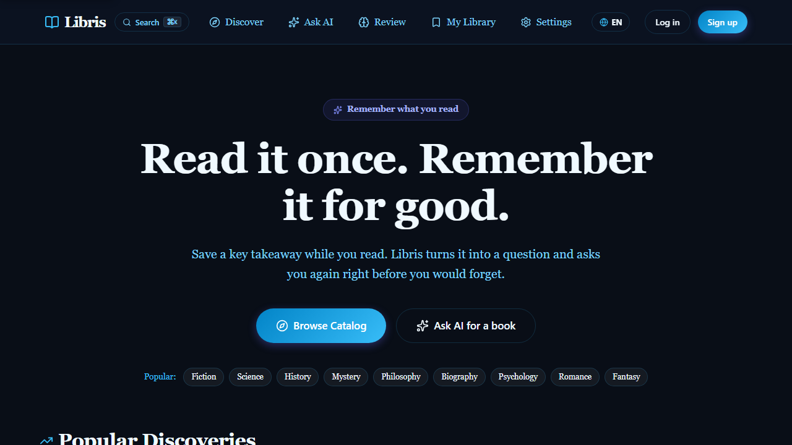
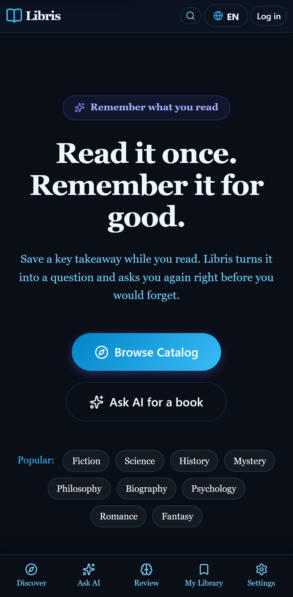
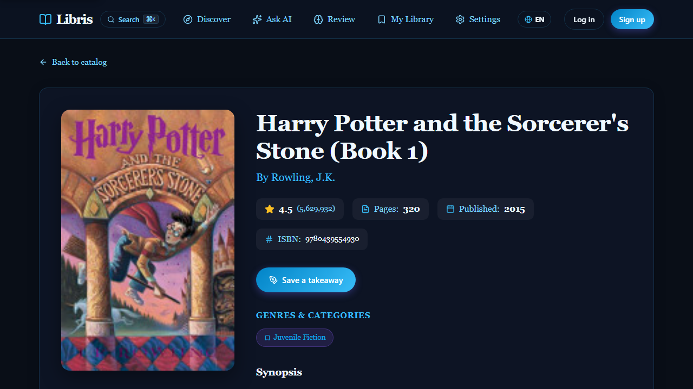
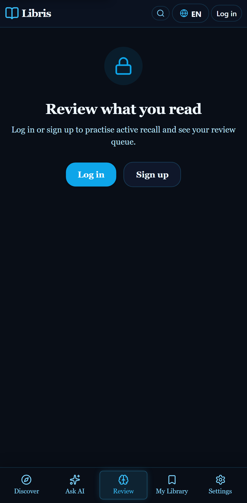

# Libris

**Remember what you read.**

**[Live demo → libris-pink.vercel.app](https://libris-pink.vercel.app)**

Most of what we read is gone within weeks. Libris is a reading companion built around one idea: you save a takeaway while reading, Libris turns it into a recall question, and asks you again right before you would forget it.

## How to use it

Open a book from **Discover** (or add it if it is missing) and press **Save a takeaway**. Write the one idea you want to keep, in your own words. Libris AI immediately turns it into a question and shows you when it will ask. When a card is due, open **Review**, answer from memory, then reveal your note and say how well you remembered. Stuck on what to read next? **Ask AI** suggests books from the catalog in plain conversation.

## Screenshots

| Desktop browser | Phone browser |
|---|---|
|  |  |
|  |  |

Both columns show the same responsive web app; there is no native mobile app.

## Why I built this

I kept finishing good books and, a month later, being unable to explain what they said. Generic flashcard apps meant writing every card by hand, so I never kept it up. I wanted reviewing to be a by-product of reading, not a second job.

It is also where I practised building a product end to end: a layered backend, a web client, real authentication with per-user data isolation, and AI features that degrade gracefully instead of breaking the app when a provider is down.

## What is inside

- **Recall questions:** an LLM (Google Gemini, `gemini-3.5-flash-lite` on the free tier) writes the question from your note; if the provider is unavailable a plain fallback question is used, so saving never fails.
- **Spaced repetition:** cards come back after 1, 3, 7, ... days and move according to how well you recalled them; a dashboard shows retention.
- **Recommendations:** a TF-IDF model trained on the ~6,400-book catalog powers "similar books"; the Ask AI assistant answers with retrieval over the same catalog.
- **Catalog contributions:** missing books are looked up on Google Books or Open Library and added through a validated, rate-limited database function. Notes always stay private.
- **Six languages:** English, Turkish, German, Spanish, French and Italian, enforced by tests so no screen ships untranslated.

Who it is for and how success would be measured are in the [product brief](docs/PRODUCT.md).

> **Status:** feature-complete portfolio project. The web app runs on Vercel and the API on Render's free tier, which sleeps when idle, so the first visit after a quiet spell can take up to a minute to load the catalog.

## Architecture

~~~mermaid
flowchart LR
    WEB["Next.js 16 · React 19"] --> API["Flask REST API"]
    API --> UC["Use cases"] --> DOMAIN["Domain models & ports"]
    ADAPTERS["Adapters"] -. implement .-> DOMAIN
    ADAPTERS --> DB[("Supabase · PostgreSQL · pgvector")]
    ADAPTERS --> AI["Gemini REST API"]
~~~

| Area | Technologies |
|---|---|
| Web | Next.js 16, React 19, TypeScript |
| Backend | Python 3.12, Flask 3, scikit-learn |
| Data | PostgreSQL 16, Supabase (Auth, RLS, pgvector) |
| Quality | Pytest, Ruff, ESLint, Playwright, GitHub Actions |

Gemini is called through its REST API rather than the `google-genai` SDK, because that SDK requires `websockets>=13`, which conflicts with the Supabase client. More detail: [docs/ARCHITECTURE.md](docs/ARCHITECTURE.md).

## Run locally

Requires Python 3.12, Node.js 22 and a Supabase project (see [docs/setup.md](docs/setup.md)).

~~~bash
# Backend: copy backend/.env.example to backend/.env and fill it in
python -m venv .venv && source .venv/bin/activate   # Windows: .venv\Scripts\Activate.ps1
pip install -r backend/requirements-test.txt
python -m backend.app                               # http://localhost:5000

# Web: copy web/.env.example to web/.env.local and fill it in
cd web && npm ci && npm run dev                     # http://localhost:3000
~~~

On Windows, `scripts/launch_dev.ps1` starts both.

## Quality checks

~~~bash
ruff check backend/ && PYTHONPATH=. python -m pytest backend/tests/
cd web && npm run lint && npm test && npm run build && npm run test:e2e
~~~

CI runs all of these, plus migration validation on a throwaway PostgreSQL and Docker builds.

## Database and security

Ordered migrations live in `backend/scripts/` (`00` to `15`). Migration 14 drops retired tables, so apply it deliberately after a backup. Read [docs/supabase_setup.md](docs/supabase_setup.md) before changing a remote database.

Keep credentials in local env files, never in git. The Supabase service-role key stays on the server, and `ALLOWED_ORIGINS` must list trusted origins explicitly in production.

## License

[MIT](LICENSE)
