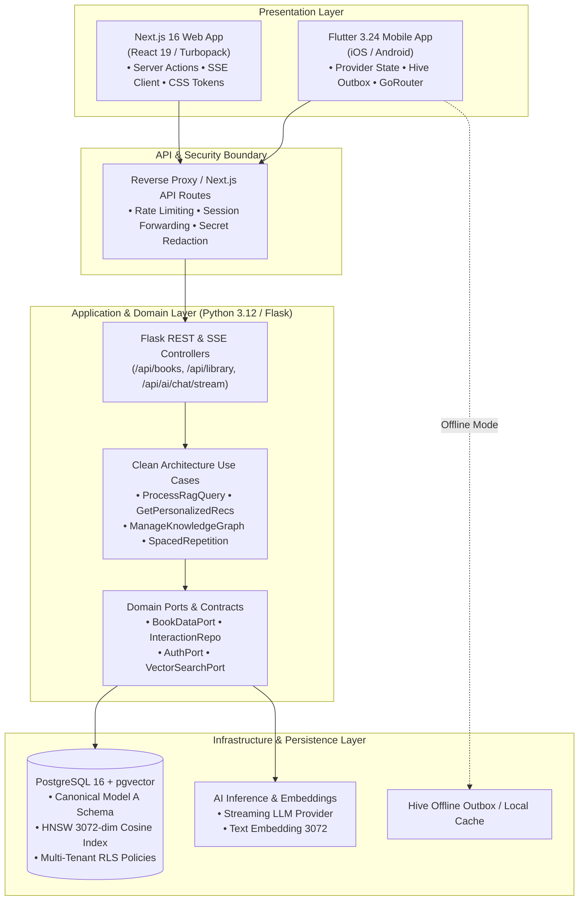

# Libris

<div align="center">

**Intelligent Literary Discovery & Personal Knowledge Architecture**

[](https://github.com/akifkeklik/book-ai-app/actions/workflows/ci_cd.yml)
[](LICENSE)
[](https://www.python.org/)
[](https://flask.palletsprojects.com/)
[](https://nextjs.org/)
[](https://react.dev/)
[](https://flutter.dev/)
[](https://www.postgresql.org/)
[](https://github.com/pgvector/pgvector)
[](https://turbo.build/pack)

An AI-assisted, multi-platform reading and personal-knowledge application built with Clean Architecture principles, retrieval-augmented generation (RAG), knowledge-graph features, learning paths, and spaced-repetition reviews across Web and Mobile.

[Key Features](#core-features) • [System Architecture](#system-architecture) • [Tech Stack](#technology-stack) • [Quick Start](#local-development-setup) • [Verification](#testing--quality-assurance) • [Docs](docs/)

</div>

---

## Table of Contents

1. [Project Overview](#project-overview)
2. [Product Vision & Engineering Philosophy](#product-vision--engineering-philosophy)
3. [Core Features](#core-features)
4. [System Architecture](#system-architecture)
5. [Technology Stack](#technology-stack)
6. [Repository Structure](#repository-structure)
7. [Mobile Application (Flutter)](#mobile-application)
8. [Web Application (Next.js 16)](#web-application)
9. [Backend Architecture (Python / Flask)](#backend-architecture)
10. [AI & Recommendation Infrastructure](#ai--recommendation-infrastructure)
11. [Database & Supabase Architecture](#database--supabase-architecture)
12. [Local Development Setup](#local-development-setup)
13. [Docker Environment](#docker-environment)
14. [Environment Variables](#environment-variables)
15. [Testing & Quality Assurance](#testing--quality-assurance)
16. [Security & Data Protection](#security--data-protection)
17. [CI/CD & Engineering Workflow](#cicd--engineering-workflow)
18. [Roadmap](#roadmap)
19. [Known Limitations](#known-limitations)
20. [Contributing](#contributing)
21. [License](#license)

---

## Project Overview

**Libris** is a unified digital library and personal knowledge intelligence application engineered to address fragmented reader experiences. Rather than treating books as static isolated catalog entries, Libris treats reading as an ongoing cognitive journey—interlinking books, personal takeaways, concepts, learning milestones, and structured recall intervals into a cohesive personal knowledge graph.

The system is deployed across three first-class platforms:
- **Mobile (iOS / Android):** A Flutter application with an optimistic local outbox and retry-based synchronization. Responsive behavior is covered by targeted tests; universal zero-overflow behavior is not claimed.
- **Web (Desktop / Tablet):** A high-performance Next.js 16 App Router application powered by React 19, Turbopack, and Server Actions.
- **Backend API:** A Python 3.12 Flask service implementing Clean Architecture with pluggable ports for relational persistence, hybrid recommendation, rate limiting, and vector RAG.

---

## Product Vision & Engineering Philosophy

Libris is built upon four non-negotiable engineering principles:

1. **Deterministic Data Integrity (Model A Invariant):**
   Personal shelves (`want_to_read`, `reading`, `finished`) and `favorites` operate with strict lifecycle independence. Changing a reading status never mutates, overwrites, or inadvertently destroys a user's favorite record.
2. **Causal Attribution & Grounding Truth:**
   Recommendations and AI answers are never hallucinated or falsely attributed. Grounding badges (`✓ Catalog Verified`) are rendered strictly when actual verified catalog evidence was retrieved; ungrounded fallback states are honestly surfaced to the reader.
3. **Responsive Design Discipline:**
   Interfaces use adaptive layout constraints and text handling. Visual QA currently captures selected routes at 390px and 1280px; this is a targeted smoke check, not an exhaustive 320px–1440px overflow proof.
4. **Isolated & Reproducible Verification:**
   All test suites run deterministically in isolated environments without mandatory external cloud connections, using embedded PostgreSQL (`pgserver`), in-memory repositories, and mock authorization adapters.

---

## Core Features

### 1. Semantic AI Discovery & Streaming SSE
- Real-time Server-Sent Events (SSE) chat interface streaming incremental tokens.
- Strict multi-byte UTF-8 boundary safety and fragmented frame reassembly.
- Upstream client cancellation propagation via `AbortController` and HTTP 499 handling.
- Honest RAG citation badges: catalog-verified books are extracted and presented with structured metadata.

### 2. Multi-Tier Recommendation Engine
- **Cold-Start Heuristics:** Onboarding taste profile capturing genre affinities, favorite authors, and reading pace using Maximal Marginal Relevance (MMR).
- **Hybrid Scoring:** Weighted combination of TF-IDF keyword similarity and 3072-dimensional dense embeddings (`gemini-embedding-2` / `pgvector`).
- **Feedback Loop & Dislike Suppression:** Explicit feedback (`like` / `dislike`) dynamically shapes user affinity vectors while immediately suppressing disliked items.

### 3. Personal Knowledge Graph
- Interactive entity-relationship model linking four node types: **Books**, **Concepts**, **Notes**, and **Learning Paths**.
- Evidence-backed relationship taxonomy: `covers_concept`, `reinforces_concept`, `relates_to`, `builds_upon`, `curates_book`, `references_book`, `derived_from`, `contrasts_with`, `prerequisite_for`.
- Subgraph filtering, depth expansion (1 to 3 hops), and cycle-safe traversal.

### 4. Adaptive Learning Paths
- Structured reading curricula organized by topic or discipline with ordered milestones.
- Adaptive personalized candidate suggestions based on path categories.
- Real-time milestone progress tracking, status transitions, and drag-and-drop book reordering.

### 5. Spaced Repetition Smart Reviews
- Leitner-inspired active recall reviews derived from reader highlights and notes, using deterministic review stages and fixed intervals (1, 3, 7, and 30 days). This is not a SuperMemo SM-2 implementation.
- Categorized note types: `personal_note`, `key_takeaway`, and `question`.
- Clean Markdown export with guaranteed preservation of Turkish and multi-byte UTF-8 characters.

### 6. Unified Personal Library
- Independent shelf state management (`want_to_read`, `reading`, `finished`) and `favorite` status.
- Real-time search, category browsing, and sorting across 6,000+ catalog titles.
- Offline-first local mutations with resilient outbox queuing.

### 7. Trilingual Runtime Localization
- Matching dictionary key sets across English (`en`), Turkish (`tr`), and German (`de`) were verified in a repository inspection.
- Key parity does not guarantee translation quality or complete runtime coverage; localization QA remains an ongoing task.

### 8. Adaptive Design System
- Six editorial color palettes: *Sapphire*, *Emerald*, *Amber*, *Rose*, *Amethyst*, and *Obsidian*.
- Light and Dark appearance modes using CSS design tokens; accessibility contrast should be verified against the current rendered UI.

---

## System Architecture



---

## Technology Stack

| Layer | Technology | Version | Purpose |
|---|---|---|---|
| **Mobile Client** | Flutter / Dart | 3.24.3 / 3.5.3 | Cross-platform native mobile application |
| **Mobile State** | Provider | ^6.1.2 | Reactive UI state management and dependency injection |
| **Mobile Offline** | Hive / Dio | ^2.2.3 / ^5.4.1 | Local key-value storage, outbox persistence, HTTP client |
| **Web Client** | Next.js / React | 16.4.3 / 19.3.0 | Full-stack server/client framework with Turbopack |
| **Web Language** | TypeScript | ^5.6.3 | Strict end-to-end type safety |
| **Web Styling** | Vanilla CSS Tokens | Custom | Apple-inspired glassmorphism design system |
| **Backend API** | Python / Flask | 3.12 / 3.0.2 | REST and SSE microservice backend |
| **Backend Architecture** | Clean Architecture | Custom | Separation of entities, use cases, ports, and adapters |
| **Security & Auth** | PyJWT / Supabase Auth | 2.15.1 | Bearer token validation and multi-tenant isolation |
| **Database** | PostgreSQL | 16.x | Relational persistence with ACID transactions |
| **Vector Engine** | pgvector | 0.7+ | 3072-dimensional dense vector embeddings with HNSW index |
| **Local Testing DB** | pgserver | 0.1.4 | In-process isolated PostgreSQL for deterministic CI testing |
| **Containerization** | Docker / Compose | Compose v2 | Isolated multi-container deployment orchestration |

---

## Repository Structure

```
book-ai-app/
├── backend/                        # Python / Flask Backend Service
│   ├── application/use_cases/      # Clean architecture business logic
│   │   ├── ai_rag.py               # RAG pipeline & streaming generation
│   │   ├── interactions.py         # Feedback, favorites, shelf state
│   │   ├── knowledge_graph.py      # Entity-relationship graph use cases
│   │   ├── learning_notes.py       # Notes & highlights
│   │   ├── learning_paths.py       # Reading curricula & suggestions
│   │   ├── recommendations.py      # Personalized recommender orchestration
│   │   └── spaced_repetition.py    # Leitner-inspired review scheduling & stats
│   ├── domain/                     # Pure domain models, enums & interfaces
│   ├── infrastructure/             # Concrete adapters (Postgres, LLM, Security)
│   ├── routes/                     # Blueprint controllers & rate limiters
│   ├── scripts/                    # Sequential SQL migrations (00 to 13)
│   │   └── hardening/              # Safe stage-gated migrations & rollback tests
│   └── tests/                      # Backend Pytest suite (see dated verification report)
├── web/                            # Next.js 16 Web Application
│   ├── src/
│   │   ├── app/                    # Next.js App Router pages & route handlers
│   │   │   ├── ai-discovery/       # Real-time SSE streaming discovery UI
│   │   │   ├── api/ai/chat/stream/ # Secure backend SSE streaming proxy
│   │   │   ├── discovery/          # Personalized recommendation view
│   │   │   ├── knowledge-graph/    # Interactive graph exploration
│   │   │   └── learning/           # Reading journey, paths & smart review
│   │   ├── components/             # Reusable UI widgets & skeletons
│   │   ├── lib/                    # API clients, normalizers, i18n dictionaries
│   │   └── types/                  # TypeScript interface definitions
│   └── src/__tests__/              # Web Node test suite (see dated verification report)
├── mobile/flutter_app/             # Flutter Mobile Application
│   ├── lib/
│   │   ├── application/use_cases/  # Mobile application layer use cases
│   │   ├── data/                   # DTOs, repositories, outbox sync service
│   │   ├── domain/                 # Domain entities and contracts
│   │   ├── providers/              # Provider state models
│   │   ├── screens/                # Mobile views (Home, Detail, Knowledge Graph)
│   │   ├── services/               # ApiService, background sync coordinator
│   │   └── theme/                  # Design system tokens and palettes
│   └── test/                       # Flutter unit/widget test suite (see dated verification report)
├── docs/                           # Architectural audit reports & specifications
├── scripts/                        # Development orchestration scripts
├── docker-compose.yaml             # Multi-service container orchestration
└── README.md                       # Engineering documentation showcase
```

---

## Mobile Application

The mobile application is crafted with Flutter 3.24, targeting Android, iOS, and Web previews with an Apple-inspired glassmorphism aesthetic.

### Highlights:
- **Resilient Offline Architecture:** Mutations (shelf updates, favorites, learning notes) are committed optimistically to a Hive local outbox and synced via `SyncCoordinator` with exponential retry backoff and conflict resolution.
- **Dynamic Text Scale:** The UI includes adaptive text and layout handling; verify individual screens and font scales on target devices before making universal no-overflow claims.
- **Biometric & Token Renewal:** Session persistence and token refresh lifecycle managed through `AuthProvider`.
- **Localization:** English, Turkish, and German dictionaries are present with matching key sets; translation quality and runtime coverage still require QA.

---

## Web Application

The web frontend is engineered with Next.js 16, React 19, and TypeScript, utilizing Turbopack for near-instant compilation and Server Actions for mutation workflows.

### Highlights:
- **Linting:** The Batch 3 report recorded a clean ESLint run. Re-run lint on the target commit before release; a clean lint result does not replace runtime or accessibility testing.
- **Streaming SSE Client:** Robust reader in `web/src/lib/ai_stream.ts` handling network frame fragmentation, multi-byte UTF-8 sequences, and client cancellation.
- **Server/Client Boundary Security:** Upstream credentials (`LIBRIS_API_KEY`) reside exclusively in server runtime and are never leaked to browser bundles.
- **Design System:** Six palettes and Dark/Light themes with dedicated skeleton loaders; formal contrast compliance should be verified with automated and manual accessibility checks.

---

## Backend Architecture

The backend service is structured according to Clean Architecture / Hexagonal Architecture:

- **Domain Layer (`backend/domain/`):** Contains business entities (`Book`, `UserInteraction`, `LearningNote`, `KnowledgeNode`, `KnowledgeEdge`) and abstract port definitions (`BookDataPort`, `InteractionRepositoryPort`, `AuthPort`).
- **Application Layer (`backend/application/`):** Contains use cases orchestrating recommendation ranking, RAG query processing, knowledge graph operations, and spaced repetition scheduling.
- **Infrastructure Layer (`backend/infrastructure/`):** Implements ports using concrete technologies:
  - `PostgresAdapters`: Direct PostgreSQL access with connection pooling.
  - `JwtAuthAdapter`: Validates Supabase JWTs and extracts claims safely.
  - `GeminiLlmAdapter` / `OpenAiLlmAdapter`: Generates grounded summaries and embeddings. Embedding task configuration for document indexing versus user-query retrieval is a known verification item.
- **Web Layer (`backend/routes/`):** Exposes REST blueprints with structured JSON logging, strict schema validation, and tiered token-bucket rate limiting.

---

## AI & Recommendation Infrastructure

Libris combines deterministic heuristics with machine learning models:

```
User Context (Genres, Authors, Activity)
         │
         ▼
┌────────────────────────────────────────┐
│      1. Candidate Retrieval            │
│   • TF-IDF Keyword Cosine Similarity   │
│   • Dense Vector Embeddings (3072-dim) │
│   • Popular / Curated Fallback Pool    │
└──────────────────┬─────────────────────┘
                   │
                   ▼
┌────────────────────────────────────────┐
│      2. Personalization & Filtering    │
│   • Hard Dislike Suppression           │
│   • Category & Author Affinity Scoring │
│   • Shelf State Exclusion (Optional)   │
└──────────────────┬─────────────────────┘
                   │
                   ▼
┌────────────────────────────────────────┐
│      3. Diversity Optimization         │
│   • Maximal Marginal Relevance (MMR)   │
│   • Cold-Start Evidence Classification │
│   • Truthful Attribution Explanation   │
└──────────────────┬─────────────────────┘
                   │
                   ▼
   Personalized Recommendations + Diagnostics
```

- **RAG Grounding Integrity:** When querying the AI assistant, catalog documents are retrieved and formatted as grounding context. If no relevant books match, the assistant transparently indicates an ungrounded state rather than fabricating citations.

---

## Database & Supabase Architecture

Libris uses PostgreSQL 16 enhanced with `pgvector` for vector operations and `pgcrypto` for UUID generation.

### Migration Sequence:
- `00_init_books.sql`: Baseline catalog schema and initial seed data.
- `01_schema.sql` to `07_phase3_collections.sql`: Catalog indexes, full-text search, and collections.
- `08_user_profiles_and_activities.sql`: User preferences, onboarding state, and audit activities.
- `09_learning_notes.sql`: Multi-type notes and highlights.
- `10_learning_notes_idempotency_and_review.sql`: Spaced repetition review stages.
- `11_learning_paths.sql`: Curated reading curricula and book ordering.
- `12_knowledge_graph.sql`: Nodes, edges, and relationship integrity rules.
- `13_learning_outcomes.sql`: Cognitive outcome recording and evaluation.

### Hardening & Safe Rollback Architecture:
Located in `backend/scripts/hardening/`, these migrations enforce:
- **Least Privilege:** Public truncate and dangerous table privileges revoked.
- **Fail-Closed Operator Gates:** Preflight scripts verify table constraints, orphaned records, and duplicate keys before migration execution.
- **Lossless Rollbacks:** Atomic transactions ensure forward migrations create snapshot backups, enabling safe rollbacks without data loss.

---

## Local Development Setup

### Prerequisites
- Python 3.12+
- Node.js 20+ and npm
- Flutter SDK 3.24+
- Docker & Docker Compose (optional for containerized execution)

### 1. One-Command Dev Launcher
Start backend, web, and mobile preview simultaneously:

**Windows PowerShell:**
```powershell
.\launch_dev.ps1
```

**Linux / macOS (Bash):**
```bash
./scripts/launch_dev.sh
```

The launcher validates environment configurations, audits ports (5000, 3000, 5001), launches background processes, monitors health endpoints, and opens the application showroom in Chrome:
- **Backend Health:** `http://127.0.0.1:5000/api/health`
- **Web Application:** `http://127.0.0.1:3000`
- **Mobile Preview:** `http://127.0.0.1:5001`

To check status or stop background dev processes:
```powershell
.\status_dev.ps1   # Check service status
.\stop_dev.ps1     # Safely stop managed processes
```

### 2. Manual Service Setup

**Backend (Python / Flask):**
```bash
cd backend
python -m pip install -r requirements.txt
python -m app
```

**Web (Next.js 16):**
```bash
cd web
npm ci
npm run dev
```

**Mobile (Flutter):**
```bash
cd mobile/flutter_app
flutter pub get
flutter run -d chrome
```

---

## Docker Environment

The multi-container stack is orchestrated via `docker-compose.yaml`:

```yaml
services:
  backend:     # Python 3.12 Flask API on port 5000
  web:         # Next.js 16 on port 3000
  postgres:    # pgvector/pgvector:pg16 on port 5432
```

### Validating Docker Compose
```powershell
$env:SECRET_KEY="replace-with-a-local-development-secret"
docker compose config
```

### Running the Vertical Slice Integration Suite Interactively
To start the isolated Compose stack and execute the 9 end-to-end integration tests:
```powershell
# 1. Start Docker Desktop and launch containers
$env:SECRET_KEY="dev-secret-key-12345"
docker compose up -d

# 2. Wait for healthy status
docker compose ps

# 3. Execute the 9 vertical-slice integration tests
python -m pytest backend/tests/test_local_vertical_slice.py -v

# 4. Teardown
docker compose down
```

---

## Environment Variables

| Variable | Service | Required? | Default / Purpose |
|---|---|---|---|
| `SECRET_KEY` | Backend | Yes | Flask session and cryptographic secret |
| `LIBRIS_API_KEY` | Backend / Web server | Deployment-dependent | Server-to-server gateway credential; never embed this secret in the Flutter/mobile app. Mobile user requests use user authentication tokens. |
| `DATABASE_URL` | Backend | Optional | PostgreSQL connection URI |
| `SUPABASE_URL` | All | Optional | Supabase API URL (mocked in test mode) |
| `SUPABASE_ANON_KEY` | All | Optional | Public anonymous client key |
| `SUPABASE_SERVICE_ROLE_KEY` | Backend | Optional | Administrative database key |
| `LLM_API_KEY` | Backend | Optional | LLM provider API key |
| `NEXT_PUBLIC_SUPABASE_URL` | Web | Yes | Public Supabase endpoint for web client |
| `NEXT_PUBLIC_SUPABASE_ANON_KEY` | Web | Yes | Public anon key for web client |
| `BACKEND_URL` | Web | Optional | Backend URL (defaults to `http://localhost:5000`) |
| `REDIS_URL` | Backend | Optional | Shared rate-limit storage for multi-worker deployments; without it, in-memory limits are process-local. |

---

## Testing & Quality Assurance

The following table records the Batch 3 verification results reported at that time. These figures are historical evidence, not a claim that the current branch has been re-tested. Re-run the commands below on the target commit before release. Tests must use isolated local/test services and must not connect to a live production database.

```
====================================================================================================
HISTORICAL TEST SUITE SUMMARY — BATCH 3 REPORTED BASELINE
====================================================================================================
Tier               Command                                              Passed    Skipped    Failed
----------------------------------------------------------------------------------------------------
Backend (Pytest)   python -m pytest backend/tests/ -v                   576       9*         0
Static Analysis    python -m ruff check backend/                        Clean     0          0
Web (Node Test)    npm --prefix web test                                217       0          0
Web Linter         npm --prefix web run lint                            Clean     0          0
Web Production     npm --prefix web run build                           Clean     0          0
Mobile Tests       flutter test (in mobile/flutter_app)                 272       1**        0
Mobile Analyzer    flutter analyze (in mobile/flutter_app)              Clean     0          0
----------------------------------------------------------------------------------------------------
BATCH 3 REPORTED TOTAL: 1,065 PASSED / 0 FAILURES (historical; not independently re-run here)
====================================================================================================
* 9 tests in test_local_vertical_slice.py require an active Docker daemon.
** 1 test skipped pending physical biometric hardware integration.
```

### Running Test Suites Locally:

**Backend Tests:**
```bash
python -m pytest backend/tests/ -v -q -k "not test_local_vertical_slice"
python -m ruff check backend/
```

**Web Tests & Linting:**
```bash
cd web
npm test
npm run lint
npm run build
```

**Mobile Tests & Analysis:**
```bash
cd mobile/flutter_app
flutter analyze
flutter test
```

---

## Security & Data Protection

- **Credentials Boundary:** Server credentials (`LIBRIS_API_KEY`, `SUPABASE_SERVICE_ROLE_KEY`, `LLM_API_KEY`) are isolated strictly within backend and Next.js server processes; they are never sent to the browser or mobile client.
- **Fail-Closed Authorization:** Personal endpoints (`/api/library`, `/api/recommend/personalized`, `/api/notes`, `/api/learning-paths`, `/api/knowledge-graph`) enforce JWT verification. Anonymous tokens cannot access personal data.
- **Multi-Tenant Isolation:** Repository queries and RLS policies include user-scoped access controls. Effective isolation must be verified against the deployed schema, grants, policies, and runtime roles; this README is not a substitute for a security audit.
- **Rate Limiting Protection:** AI discovery and recommendation endpoints include rate-limiting controls. The default in-memory limiter is process-local; configure `REDIS_URL` for shared multi-worker limits and validate the selected failure policy.
- **Input Validation & Sanitization:** Query inputs, ISBNs, and payload sizes are bounded and validated against injection attacks, path traversal, and malicious payloads.
- **Safe Test Isolation:** CI and unit tests use isolated in-process mock targets or local PostgreSQL (`pgserver`); connection to live production databases is strictly barred by test assertions.

---

## CI/CD & Engineering Workflow

Automated verification is governed by GitHub Actions (`.github/workflows/ci_cd.yml`):

1. **`database-ci`:** Applies SQL migrations sequentially (`00` to `13`) on isolated PostgreSQL 16 and executes forward/rollback hardening rehearsals.
2. **`backend-ci`:** Executes `ruff check backend/` and full Pytest unit and functional suites.
3. **`docker-ci`:** Validates container builds for both backend and web images.
4. **`frontend-ci`:** Runs `flutter analyze --no-fatal-infos` and `flutter test` across all mobile modules.
5. **`backend-integration-ci`:** Executes real persistence integration tests against PostgreSQL service containers.
6. **`web-ci`:** Runs `npm run lint`, `npm test`, and `npm run build` with Turbopack.
7. **`visual-qa-ci`:** Runs a targeted screenshot/DOM smoke check for configured routes and viewports. It does not prove universal responsive correctness or automatically detect every overflow.

---

## Roadmap

### Delivered Milestones (Current Architecture)
- [x] Multi-platform Clean Architecture with domain, use case, and port separation.
- [x] Model A personal library and favorites lifecycle independence.
- [x] Streaming AI discovery with SSE and honest grounding verification.
- [x] Hybrid recommendation engine (TF-IDF + pgvector embeddings + feedback loop).
- [x] Bidirectional personal knowledge graph with 9 evidence-based relationship types.
- [x] Curated and adaptive learning paths with milestone progress tracking.
- [x] Leitner-inspired spaced-repetition active recall with deterministic stage scheduling and Markdown export.
- [x] Offline-first mobile outbox synchronization with conflict resolution.
- [x] English, Turkish, and German localization dictionaries with matching key sets (translation quality and runtime coverage still require QA).
- [x] Stage-gated database hardening with preflight checks and rollback rehearsals; production safety depends on the exact migration, operator gates, and target environment.

### Future Milestones (Planned)
- [ ] Cross-device end-to-end encryption for private reading notes.
- [ ] Collaborative reading circles and shared learning path curricula.
- [ ] Audio book narration synthesis and synchronized chapter transcripts.
- [ ] Native iPad and Android tablet dual-pane reading companion layout.
- [ ] Local offline LLM inference via ONNX Runtime / WebAssembly.

---

## Known Limitations

- **Docker Desktop Daemon in Headless Sessions:** Compose integration tests require an active Docker daemon. The Batch 3 report recorded nine vertical-slice tests as not run when the daemon was unavailable; current test counts must be regenerated from the commit being released.
- **Embedded pgserver on Windows:** When using `pgserver` for real PostgreSQL integration tests in Python on Windows, worker cleanup may log a transient `ValueError: I/O operation on closed file` during process termination; this does not affect test assertions or database consistency.
- **Biometric Authentication:** Biometric login tests on mobile are mocked in CI; physical biometric sensor verification requires deployment to a physical device or emulator with biometric enrollment.

---

## Contributing

We welcome contributions adhering to Libris's engineering standards:

1. **Branch Hygiene:** Create descriptive branches (`feat/feature-name`, `fix/issue-description`).
2. **Quality Gates:** Ensure all verification gates pass before submitting a pull request:
   - `python -m ruff check backend/`
   - `python -m pytest backend/tests/`
   - `npm --prefix web run lint && npm --prefix web test && npm --prefix web run build`
   - `flutter analyze && flutter test` (in `mobile/flutter_app`)
3. **Commit Standards:** Use Conventional Commits format (`feat:`, `fix:`, `docs:`, `test:`, `refactor:`).
4. **Data Safety:** Never commit secrets, credentials, or live database connection strings.

---

## License

This project is licensed under the MIT License — see the [LICENSE](LICENSE) file for details.

---

<div align="center">
<sub>Crafted with engineering discipline for curious minds.</sub>
</div>
