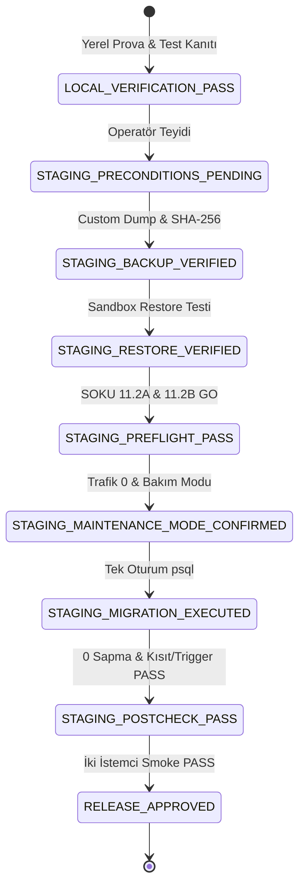

# LIBRIS — MIGRATION 03 STAGING OPERASYONEL RUNBOOK VE SÜRÜM GEÇİŞİ (RELEASE GATE)

> [!CAUTION]
> **KRİTİK GÜVENLİK VE YETKİ SINIRI UYARISI**:
> Bu belge **canlıya (production) doğrudan geçiş izni VERMEZ**. Yerel prova sonuçlarının başarılı olması, staging veya canlı ortamlarda otomatik uygulama yetkisi tanımaz. Staging operasyonu, ayrı ve bağımsız bir operatör/mühendislik onayı gerektirir. Canlı geçişi ise staging üzerindeki doğrulama ve smoke test kanıtlarının eksiksiz sunulmasının ardından ayrı bir release gate ile değerlendirilecektir.

---

## 1. Operasyon Özeti ve Değişiklik Kapsamı

- **İlgili Migration**: `backend/scripts/hardening/03_DRAFT_reconcile_interactions_and_trigger.sql`
- **İlgili Rollback**: `backend/scripts/hardening/03_DRAFT_reconcile_interactions_and_trigger_rollback.sql`
- **Hedef Mimari**: Model A (Bağımsız Favori ve Okuma Durumu Havuzu)
  1. `public.favorites` tablosu favori üyeliğinin kanonik deposudur.
  2. `public.user_interactions` tablosu okuma durumlarını (`want_to_read`, `reading`, `finished`) ve tavsiye motoru beğeni sinyallerini (`like`, `dislike`, `favorite`) yönetir.
  3. `public.user_interactions` CHECK kısıtı 6 durumu kapsayacak şekilde genişletilir: `('like', 'dislike', 'want_to_read', 'reading', 'finished', 'favorite')`.
  4. Mükerrer `(user_id, book_id)` satırları sıfır veri kaybıyla `_archived_user_interactions_duplicate_backup` tablosuna snapshot alınır, favori sinyalleri `favorites` tablosuna aktarılır ve okuma durumları deterministik öncelikle (`finished` > `reading` > `want_to_read` > `dislike` > `like` > `favorite`) korunur.
  5. Eski `DO UPDATE SET interaction_type = 'like'` trigger'ı kaldırılarak `ON CONFLICT DO NOTHING` esaslı koruyucu Model A trigger'ı tesis edilir. Trigger'ın DELETE dalı yalnızca saf favori (`interaction_type = 'favorite'`) kayıtlarını temizler; okuma durumları (`reading`, `finished`, `want_to_read`) ile bağımsız tavsiye/beğeni sinyalleri (`like`, `dislike`) kesinlikle korunur.

---

## 2. Operasyon Öncesi Yedek ve Geri Yükleme Doğrulaması

### 2.0 Fail-Closed Operatör Ön Koşulu ve Ortam Doğrulaması (Prerequisite Gate)

> [!CAUTION]
> **KANONİK BAĞLANTI DEĞİŞKENİ VE HATA GÜVENLİĞİ SÖZLEŞMESİ**:
> 1. **Tek Kanonik Değişken Adı**: Tüm runbook komutları ve operasyonel otomasyon istisnasız **`STAGING_DB_URL`** ortam değişkenini kullanmalıdır (`STAGING_DB_URI` kullanımdan kaldırılmıştır).
> 2. **Tanımsız / Boş Değişken Reddi (Fail-Closed)**: `STAGING_DB_URL` tanımlı değilse veya boşsa işlem sessizce varsayılana geçmez; derhal çıkış kodu `1` ile durdurulur.
> 3. **Localhost / Loopback Koruması**: Canlı/staging operasyonu asla yanlışlıkla yerel (`localhost`, `127.0.0.1`, `::1`) veritabanına bağlanmamalı veya yerel bağlantıya sessizce düşmemelidir.
> 4. **Kimlik Bilgisi Maskeleme**: Bağlantı URI'si veya veritabanı parolası terminal loglarına, hata çıktılarına veya artifact dosyalarına asla açık metin yazdırılmaz.
> 5. **Açık Operatör Teyidi**: Operatör, işlem başlamadan önce hedeflenen staging sunucu adresini (`host`) ve veritabanı adını (`dbname`) açıkça doğrulamalı ve onaylamalıdır.

```bash
# [STAGING-ONLY] Operatör Staging Ortam Doğrulama ve Güvenlik Ön Kontrolü:
if [ -z "${STAGING_DB_URL:-}" ]; then
  echo "HATA: STAGING_DB_URL ortam değişkeni tanımlı değil veya boş! İşlem fail-closed durduruldu." >&2
  exit 1
fi

# Yanlışlıkla localhost / loopback hedefleme koruması:
if echo "$STAGING_DB_URL" | grep -Eq 'localhost|127\.0\.0\.1|::1'; then
  echo "HATA: STAGING_DB_URL yerel adrese (localhost/loopback) işaret ediyor! Staging operasyonu izole uzak ortama yapılmalıdır." >&2
  exit 1
fi

# Kimlik bilgilerini loglara basmadan yalnızca host ve veritabanı adını maskeli ayıkla:
TARGET_HOST=$(echo "$STAGING_DB_URL" | sed -E 's|^.*@([^:/]+).*$|\1|')
TARGET_DB=$(echo "$STAGING_DB_URL" | sed -E 's|^.*/([^?]+).*$|\1|')
echo "Hedef Doğrulandı: Sunucu=[$TARGET_HOST], Veritabanı=[$TARGET_DB]"

# Operatörden açık teyit iste:
read -r -p "Bu komutların '$TARGET_HOST' üzerindeki '$TARGET_DB' veritabanında çalıştırılacağını onaylıyor musunuz? (evet/hayir): " CONFIRM
if [ "$CONFIRM" != "evet" ]; then
  echo "Operatör işlemi iptal etti."
  exit 1
fi
```

> [!IMPORTANT]
> **YEDEK VE RESTORE KANITI ŞARTI**:
> Aşağıdaki yedekleme ve geri yükleme provası adımları staging ortamında **migration çalıştırılmadan önce veritabanı operatörü tarafından bizzat icra edilmeli ve kanıtları kayıt altına alınmalıdır**. Bu adımlar staging üzerinde henüz **YAPILMAMIŞTIR**; staging işlemi öncesi tamamlanması zorunlu bir bloklayıcı kapıdır.

| Adım | İşlem Açıklaması ve Gerçek Komut | Sorumlu | Durum | Kanıt / Çıktı Gereksinimi |
| :--- | :--- | :--- | :---: | :--- |
| 2.1 | **Tam Custom Format Yedek Alınması**:<br>`pg_dump -Fc -v --no-owner --no-privileges -d "$STAGING_DB_URL" -f "staging_libris_pre_migration_03_$(date +%Y%m%d_%H%M%S).dump"` | Veritabanı Operatörü | `[BEKLİYOR]` | Dump dosya boyutu (bytes) ve artifact yolu |
| 2.2 | **Kriptografik SHA-256 Hash Doğrulaması**:<br>`sha256sum staging_libris_pre_migration_03_*.dump`<br>*(PowerShell: `Get-FileHash -Algorithm SHA256 staging_libris_pre_migration_03_*.dump`)* | Veritabanı Operatörü | `[BEKLİYOR]` | 64 karakterlik SHA-256 sağlama toplamı çizelgeye kaydedilecek |
| 2.3 | **İzole Sandbox Veritabanına Restore Provası**:<br>`createdb libris_staging_sandbox && pg_restore -d libris_staging_sandbox --clean --if-exists --no-owner --no-privileges staging_libris_pre_migration_03_*.dump`<br>*(Exit code `0` olmalı; stderr üzerinde ölümcül hata bulunmamalıdır)* | Veritabanı Operatörü | `[BEKLİYOR]` | Sandbox geri yükleme logu ve satır sayısı teyidi |
| 2.4 | **Kritik Tabloların Salt Okunur CSV/SQL Dökümü**:<br>`psql "$STAGING_DB_URL" -c "\copy public.user_interactions TO 'ui_pre.csv' CSV HEADER;"`<br>`psql "$STAGING_DB_URL" -c "\copy public.favorites TO 'fav_pre.csv' CSV HEADER;"` | Veritabanı Operatörü | `[BEKLİYOR]` | Dışa aktarılan dosya satır sayıları preflight sayaçlarıyla örtüşmeli |

---

## 3. Preflight Kontrolleri ve Durdurma (NO-GO) Koşulları

Aşağıdaki SQL sorgularının **yalnızca SELECT** kullandığı statik olarak doğrulanmıştır. Staging ortamında bu sorgular salt okunur çalıştırılmalı ve sonuçlar değerlendirilmelidir:

### Kontrol 3.1: Çözümlenemez Like/Dislike Çelişkileri
```sql
SELECT user_id, book_id, count(DISTINCT interaction_type) AS distinct_types
FROM public.user_interactions
WHERE interaction_type IN ('like', 'dislike')
GROUP BY user_id, book_id
HAVING count(DISTINCT interaction_type) > 1;
```
- **Durdurma Koşulu (NO-GO)**: `count > 0` (Aynı kullanıcı-kitap çifti için hem like hem dislike kaydı varsa migration bilerek fail-closed exception fırlatır; operasyon derhal durdurulur).
- **Hedef Sonuç**: `0` satır.

### Kontrol 3.2: Yabancı Anahtar İhlali Yaratabilecek Mükerrer Yetim Etkileşimler
```sql
SELECT ui.id, ui.user_id, ui.book_id, ui.interaction_type,
       CASE 
           WHEN NOT EXISTS (SELECT 1 FROM public.books b WHERE b.isbn13 = ui.book_id) THEN 'ORPHAN_BOOK_ID'
           WHEN NOT EXISTS (SELECT 1 FROM auth.users u WHERE u.id = ui.user_id) THEN 'ORPHAN_USER_ID'
           ELSE 'UNKNOWN_FK_DEFECT'
       END AS defect_reason
FROM public.user_interactions ui
WHERE (ui.user_id, ui.book_id) IN (
    SELECT user_id, book_id FROM public.user_interactions GROUP BY user_id, book_id HAVING count(*) > 1
)
AND ui.interaction_type IN ('favorite', 'like')
AND (
    NOT EXISTS (SELECT 1 FROM public.books b WHERE b.isbn13 = ui.book_id)
    OR NOT EXISTS (SELECT 1 FROM auth.users u WHERE u.id = ui.user_id)
);
```
- **Durdurma Koşulu (NO-GO)**: `count > 0` (`favorites` tablosundaki `book_id` -> `public.books(isbn13)` ve `user_id` -> `auth.users(id)` referanslarına sahiptir. Duplicate satırlardaki favori aktarımı sırasında yetim kayıt FK ihlali `23503` fırlatarak transaction'ı patlatır).
- **Hedef Sonuç**: `0` satır.

### Kontrol 3.2b: Tüm Tekil ve Mükerrer Yetim Etkileşim Kombinasyonları (user_interactions Genel Katalog Bütünlüğü)
```sql
SELECT ui.id, ui.user_id, ui.book_id, ui.interaction_type,
       CASE 
           WHEN NOT EXISTS (SELECT 1 FROM public.books b WHERE b.isbn13 = ui.book_id) THEN 'ORPHAN_BOOK_ID'
           WHEN NOT EXISTS (SELECT 1 FROM auth.users u WHERE u.id = ui.user_id) THEN 'ORPHAN_USER_ID'
           ELSE 'UNKNOWN_FK_DEFECT'
       END AS defect_reason,
       (SELECT count(*) FROM public.user_interactions ui2 WHERE ui2.user_id = ui.user_id AND ui2.book_id = ui.book_id) AS pair_occurrence_count
FROM public.user_interactions ui
WHERE (
    NOT EXISTS (SELECT 1 FROM public.books b WHERE b.isbn13 = ui.book_id)
    OR NOT EXISTS (SELECT 1 FROM auth.users u WHERE u.id = ui.user_id)
);
```
- **Açıklama**: Bu sorgu hem tekil (`pair_occurrence_count = 1`) hem mükerrer (`pair_occurrence_count > 1`) tüm yetim etkileşimleri listeler. Tekil yetimler `favorites`'a taşınmadığı için migration'ın çökmesine yol açmaz; ancak veri ambarı ve tavsiye motoru temizliği açısından tespit edilip raporlanmalıdır.
- **Hedef Sonuç**: Bilgilendirme ve denetim (İdeal: `0`).

### Kontrol 3.3: NULL veya Boşluk İçeren Kimlik Değerleri (user_interactions)
```sql
SELECT count(*) AS invalid_identifier_count
FROM public.user_interactions
WHERE user_id IS NULL OR book_id IS NULL OR trim(book_id) = '';
```
- **Açıklama**: Bu satırlar migration tarafından `_archived_user_interactions_duplicate_backup` tablosuna `ARCHIVED_NULL_OR_EMPTY_IDENTIFIER` olarak arşivlenir ve tablodan silinir.
- **Kayıt**: Arşivlenecek satır sayısı preflight sırasında kaydedilmeli ve Bölüm 4 metrikleriyle birebir eşleşmelidir.

### Kontrol 3.4: Mevcut Mükerrer Kayıt (Duplicate) Hacmi
```sql
SELECT count(*) AS total_duplicate_pairs, COALESCE(sum(dup_rows), 0) AS total_affected_rows
FROM (
    SELECT user_id, book_id, count(*) AS dup_rows
    FROM public.user_interactions
    GROUP BY user_id, book_id
    HAVING count(*) > 1
) sub;
```
- **Açıklama**: Arşiv snapshot tablosuna `PRE_DEDUPLICATION_SNAPSHOT` olarak yazılacak satır sayısını (`total_affected_rows`) belirler.

### Kontrol 3.5: favorites Tablosunda Mükerrer Kayıt veya FK / Kimlik İhlalleri
```sql
SELECT 
    (SELECT count(*) FROM (
        SELECT user_id, book_id FROM public.favorites GROUP BY user_id, book_id HAVING count(*) > 1
    ) dup_fav) AS duplicate_favorites_count,
    (SELECT count(*) FROM public.favorites f 
     WHERE NOT EXISTS (SELECT 1 FROM public.books b WHERE b.isbn13 = f.book_id)) AS orphan_book_favorites_count,
    (SELECT count(*) FROM public.favorites f 
     WHERE NOT EXISTS (SELECT 1 FROM auth.users u WHERE u.id = f.user_id)) AS orphan_user_favorites_count,
    (SELECT count(*) FROM public.favorites 
     WHERE user_id IS NULL OR book_id IS NULL OR trim(book_id) = '') AS invalid_identifier_favorites_count;
```
- **Durdurma Koşulu (NO-GO)**: Herhangi bir sayaç `> 0` ise operasyon durdurulur (`favorites` tablosundaki veriler Bölüm 6'da `user_interactions` tablosuna backfill edilirken FK ihlali veya kısıt hatası üretmemelidir).
- **Hedef Sonuç**: Tüm alanlar `0`.

### Kontrol 3.6: Arşivleme, Silme, Aktarma ve Geriye Dönük Backfill Hacmi Simülasyonu
```sql
WITH null_rows AS (
    SELECT count(*) AS cnt FROM public.user_interactions WHERE user_id IS NULL OR book_id IS NULL OR trim(book_id) = ''
),
dup_stats AS (
    SELECT 
        count(*) AS dup_pairs,
        COALESCE(sum(cnt), 0) AS total_dup_rows,
        COALESCE(sum(cnt - 1), 0) AS rows_to_delete_from_dups
    FROM (
        SELECT user_id, book_id, count(*) AS cnt 
        FROM public.user_interactions 
        WHERE user_id IS NOT NULL AND book_id IS NOT NULL AND trim(book_id) <> ''
        GROUP BY user_id, book_id 
        HAVING count(*) > 1
    ) d
),
fav_transfer AS (
    SELECT count(DISTINCT (ui.user_id, ui.book_id)) AS new_favorites_to_insert
    FROM public.user_interactions ui
    WHERE (ui.user_id, ui.book_id) IN (
        SELECT user_id, book_id FROM public.user_interactions GROUP BY user_id, book_id HAVING count(*) > 1
    )
    AND ui.interaction_type IN ('favorite', 'like')
    AND NOT EXISTS (
        SELECT 1 FROM public.favorites f WHERE f.user_id = ui.user_id AND f.book_id = ui.book_id
    )
),
backfill_fav AS (
    SELECT count(*) AS fav_to_backfill_count
    FROM public.favorites f
    WHERE NOT EXISTS (
        SELECT 1 FROM public.user_interactions ui WHERE ui.user_id = f.user_id AND ui.book_id = f.book_id
    )
)
SELECT 
    n.cnt AS archived_and_deleted_invalid_rows,
    d.total_dup_rows AS archived_duplicate_snapshots,
    d.rows_to_delete_from_dups AS duplicate_rows_to_delete,
    (n.cnt + d.rows_to_delete_from_dups) AS total_rows_to_delete_from_interactions,
    ft.new_favorites_to_insert AS duplicate_favorites_to_transfer,
    bf.fav_to_backfill_count AS legacy_favorites_to_backfill
FROM null_rows n, dup_stats d, fav_transfer ft, backfill_fav bf;
```
- **Açıklama**: Migration öncesi ve sonrası satır sayıları arasındaki matematiksel mutabakatı önceden tam doğrulukla hesaplar.

### Kontrol 3.7: Baseline Katalog, Kolon, Kısıt ve Trigger Uyumu
```sql
SELECT 
    (SELECT count(*) = 4 FROM information_schema.tables 
     WHERE table_schema IN ('public', 'auth') 
       AND (table_schema, table_name) IN (
           ('public', 'user_interactions'),
           ('public', 'favorites'),
           ('public', 'books'),
           ('auth', 'users')
       )) AS all_tables_exist,
    (SELECT count(*) = 5 FROM information_schema.columns
     WHERE table_schema = 'public' AND table_name = 'user_interactions'
       AND column_name IN ('id', 'user_id', 'book_id', 'interaction_type', 'created_at')
    ) AS ui_columns_valid,
    (SELECT count(*) >= 4 FROM information_schema.columns
     WHERE table_schema = 'public' AND table_name = 'favorites'
       AND column_name IN ('user_id', 'book_id', 'book_title', 'added_at')
    ) AS fav_columns_valid,
    (SELECT count(*) FROM pg_constraint 
     WHERE conrelid = 'public.user_interactions'::regclass AND conname = 'user_interactions_interaction_type_check'
    ) AS current_check_exists,
    (SELECT count(*) FROM pg_trigger WHERE tgname = 'trg_sync_favorites') AS current_trigger_exists;
```
- **Durdurma Koşulu (NO-GO)**: `all_tables_exist = false`, `ui_columns_valid = false` veya `fav_columns_valid = false` ise durdurulur.

---

### Preflight Sorguları Doğruluk ve Kapsam Matrisi

| Kontrol | Neyi Yakalar? | Neyi Yakalamaz? | Yanlış Negatif Riski | Statik SELECT Doğrulaması |
| :--- | :--- | :--- | :--- | :---: |
| **3.1 Like/Dislike Çatışması** | Aynı `(user_id, book_id)` için hem `'like'` hem `'dislike'` satırının bulunmasını | Diğer durum kombinasyonlarını (örn. `want_to_read` + `dislike` çelişkisi sayılmaz; Model A deterministik önceliğiyle çözülür) | Çok düşük (Canlı CHECK kısıtı harici değerleri engeller) | **EVET** (Yalnızca SELECT) |
| **3.2 Duplicate Yetim FK Kayıtları** | Mükerrer satırlardan `favorites`'a taşınacak ancak `books(isbn13)` veya `auth.users(id)`'de karşılığı olmayan kayıtları | Tekil (`count=1`) yetim etkileşimleri (`favorites`'a aktarılmadığı için migration'ı patlatmaz) | Düşük | **EVET** (Yalnızca SELECT) |
| **3.2b Genel Yetim Etkileşimler** | `user_interactions` tablosundaki tüm tekil ve mükerrer yetim kullanıcı ve kitap kombinasyonlarını | `favorites` tablosu yetimlerini (3.5 kapsamındadır) | Yok (Tüm satırlar taranır) | **EVET** (Yalnızca SELECT) |
| **3.3 Geçersiz Kimlikler (UI)** | `user_interactions` tablosundaki NULL `user_id`, NULL `book_id` ve boşluklu `book_id` kayıtlarını | `favorites` tablosundaki boş/NULL kayıtları (3.5 kapsamındadır) | Sıfır (Tüm NULL/boşluk koşulları açıkça filtrelenir) | **EVET** (Yalnızca SELECT) |
| **3.4 Duplicate Hacmi** | `(user_id, book_id)` çifti bazında 1'den fazla kaydı olan tüm grupları ve toplam satır sayısını | Mükerrer satırların alt tiplerini (arşivleme/aktarma detayları 3.6'dadır) | Yok (GROUP BY HAVING count > 1 tam kapsar) | **EVET** (Yalnızca SELECT) |
| **3.5 Favorites Bütünlüğü** | `favorites` tablosundaki mükerrer çiftleri, yetim kitap ve kullanıcıları, NULL/boş kimlikleri | Tablo dışı ilişkileri | Yok | **EVET** (Yalnızca SELECT) |
| **3.6 Hacim Simülasyonu** | Silinecek, kopyalanacak, dönüştürülecek ve backfill edilecek satırların kesin sayılarını | Eşzamanlı canlı yazma olursa migration anındaki anlık farkları | Düşük (İstemciler bakım modunda olmalıdır) | **EVET** (Yalnızca SELECT) |
| **3.7 Katalog Uyumu** | Hedef tabloların, beklenen kolonların, baseline kısıtın ve trigger'ın katalogdaki varlığını | Fonksiyon gövdesi içindeki iç mantık hatalarını (test_03 kapsamındadır) | Yok | **EVET** (Yalnızca SELECT) |

> [!IMPORTANT]
> **EŞZAMANLI YAZMA (CONCURRENT WRITES) ÖNLEME PROSEDÜRÜ**:
> Bütün preflight sorguları (3.1-3.7) kesin olarak **salt okunurdur (SELECT)** ve veritabanı durumunu değiştirmez. Preflight kontrolleri ile migration çalıştırma arasında oluşabilecek veri kaymasını (drift) ve kilitlenmeyi engellemek için:
> 1. Web uygulaması ve arka plan işçileri preflight öncesinde **bakım moduna (maintenance mode)** alınmalıdır.
> 2. Migration betiği transaction başında kilit güvenliği uygular (`SET LOCAL lock_timeout = '5s'`).
> 3. Preflight sorgularının `0` satır döndürmesi tek başına yeterli kabul edilmez; metrik çizelgesi (Bölüm 4) ve yedekleme kanıtı (Bölüm 2) ile çapraz doğrulanır.

---

## 4. Migration Öncesi Baseline Metrikleri ve Değişim Formülleri

Migration başlamadan hemen önce aşağıdaki sayaçlar kaydedilmelidir:

```sql
SELECT 
    (SELECT count(*) FROM public.user_interactions) AS count_user_interactions,
    (SELECT count(*) FROM public.favorites) AS count_favorites,
    (SELECT count(*) FROM public.books) AS count_books,
    (SELECT count(*) FROM auth.users) AS count_auth_users;
```

Aşağıdaki formüller Kontrol 3.6 simülasyonu ile birebir örtüşmelidir:

| Metrik | Öncesi Değer | Sonrası Beklenen Matematiksel Değer | Gerçekleşen Sonrası | Sapma Toleransı |
| :--- | :---: | :--- | :---: | :---: |
| `user_interactions` satır sayısı | $Count_{pre}^{UI}$ | $Count_{pre}^{UI} - (\text{archived\_invalid} + \text{dup\_rows\_deleted}) + \text{legacy\_fav\_backfilled}$ | `[BEKLENİYOR]` | **0 (Sıfır Sapma)** |
| `favorites` satır sayısı | $Count_{pre}^{FAV}$ | $Count_{pre}^{FAV} + \text{new\_favorites\_transferred}$ | `[BEKLENİYOR]` | **0 (Sıfır Sapma)** |
| `_archived_user_interactions_duplicate_backup` | `0` (Yok) | $\text{archived\_invalid} + \text{archived\_duplicate\_snapshots}$ | `[BEKLENİYOR]` | **0 (Sıfır Sapma)** |

---

## 5. Staging Uygulama Adımları

> [!IMPORTANT]
> Migration yalnızca `psql` veya doğrudan PostgreSQL CLI üzerinden, `ON_ERROR_STOP=1` parametresiyle tek bir transaction içinde icra edilmelidir.

```bash
# [STAGING-ONLY] 5.1 Standart Staging psql çalıştırma komutu (Tek transaction, fail-closed)
psql "$STAGING_DB_URL" -v ON_ERROR_STOP=1 -f backend/scripts/hardening/03_DRAFT_reconcile_interactions_and_trigger.sql

# [STAGING-ONLY] 5.2 Birden fazla bekleyen rollback attempt varlığında hedefli forward-recovery:
# KRİTİK: Oturum ayarı ve dosya MUTLAKA TEK BİR psql oturumunda birlikte verilmelidir!
psql "$STAGING_DB_URL" -v ON_ERROR_STOP=1 \
  -c "SET libris.recovery_attempt_id = '<TARGET_ATTEMPT_UUID>';" \
  -f backend/scripts/hardening/03_DRAFT_reconcile_interactions_and_trigger.sql
```

Uygulama esnasında izlenecek aşamalar:
1. Ön koşul kontrolleri çalışır (tabloların varlığı).
2. `_archived_user_interactions_duplicate_backup` tablosu oluşturulur; yetkileri `anon`/`authenticated` için kapatılır.
3. Boş kimlikli satırlar arşivlenip tablodan arındırılır.
4. Eski `trg_sync_favorites` trigger'ı düşürülür (çakışma önleme).
5. Mükerrer satırlar arşiv snapshot tablosuna yazılır.
6. Favori sinyalleri `favorites` tablosuna aktarılır.
7. Like/dislike çelişki denetimi yapılır (varsa fail-closed rollback tetiklenir).
8. Deterministik öncelik sıralamasıyla duplicate satırlar silinir.
9. `unique_user_book_interaction` UNIQUE kısıtı eklenir.
10. `user_interactions_interaction_type_check` 6 duruma genişletilir.
11. Varsa önceki rollback arşivinden forward-recovery uygulanır.
12. Model A `sync_favorites_to_interactions()` fonksiyonu (`SECURITY DEFINER`, `search_path = public, pg_temp`) ve trigger'ı kurulur.
13. Geçmiş favori verileri `ON CONFLICT DO NOTHING` ile senkronize edilir.
14. Transaction `COMMIT` edilir.

---

## 6. Migration Sonrası Doğrulama (Post-Migration Gates)

Migration tamamlandıktan sonra aşağıdaki doğrulama sorguları icra edilir:

```sql
-- 6.1 UNIQUE ve CHECK kısıtları doğrulaması
SELECT conname, contype, pg_get_constraintdef(oid)
FROM pg_constraint
WHERE conrelid = 'public.user_interactions'::regclass
  AND conname IN ('unique_user_book_interaction', 'user_interactions_interaction_type_check');

-- 6.2 Trigger ve Fonksiyon Durumu
SELECT tgname, tgenabled, proname, prosecdef, proconfig
FROM pg_trigger trg
JOIN pg_proc p ON p.oid = trg.tgfoid
WHERE trg.tgname = 'trg_sync_favorites';

-- 6.3 Arşiv Tablosu Güvenliği (RLS ve Yetkiler)
SELECT relname, relrowsecurity, 
       has_table_privilege('authenticated', 'public._archived_user_interactions_duplicate_backup', 'SELECT') AS auth_can_select,
       has_table_privilege('anon', 'public._archived_user_interactions_duplicate_backup', 'SELECT') AS anon_can_select,
       has_table_privilege('service_role', 'public._archived_user_interactions_duplicate_backup', 'SELECT') AS service_can_select
FROM pg_class
WHERE relname = '_archived_user_interactions_duplicate_backup';
```

- **Kabul Kriteri (PASS)**:
  - `unique_user_book_interaction` mevcut (`contype = 'u'`).
  - `user_interactions_interaction_type_check` 6 durumu içeriyor.
  - `trg_sync_favorites` aktif (`tgenabled = 'O'`).
  - `sync_favorites_to_interactions` fonksiyonunda `prosecdef = true` (`SECURITY DEFINER`) ve `proconfig` içinde `search_path=public, pg_temp` tanımlı.
  - Arşiv tablosunda `relrowsecurity = true`, `auth_can_select = false`, `anon_can_select = false`, `service_can_select = true`.

---

## 7. Web ve Flutter Smoke Test Planı

Migration sonrasında staging ortamında iki istemci için aşağıdaki işlevsel test senaryoları koşulur:

### Web İstemcisi Smoke Testleri (`web/src/app/actions/library.ts`):
1. **Okuma Durumu Ekleme**: Bir kitap için `reading` durumu seçilir. `user_interactions` tablosunda `reading` olduğu, `favorites` tablosuna yazılmadığı doğrulanır.
2. **Favori Ekleme**: Aynı kitap favorilere eklenir. `favorites` tablosuna eklendiği, ancak `user_interactions` tablosundaki `reading` durumunun **ezilmediği** (`reading` kaldığı) doğrulanır.
3. **Favoriden Çıkarma**: Kitap favorilerden çıkarılır. `favorites` tablosundan silindiği, ancak `user_interactions` tablosundaki `reading` durumunun **silinmediği** doğrulanır.
4. **Kitap Bitirme**: Kitap `finished` olarak işaretlenir. `user_interactions` tablosunda `finished` olduğu doğrulanır.
5. **Beğeni ('like') Sinyali Koruma**: Bir kitap için `like` feedback'i verilir. Kitap favorilere eklenip daha sonra favorilerden çıkarıldığında, `user_interactions` tablosundaki `like` sinyalinin **kesinlikle silinmediği** (`like` olarak kaldığı) doğrulanır.

### Flutter İstemcisi Smoke Testleri (`mobile/flutter_app/lib/services/supabase_service.dart`):
1. **Favorileri Listeleme**: `getFavorites` çağrısının kullanıcının güncel favori kitaplarını eksiksiz listelediği doğrulanır.
2. **Mobil Favori Ekleme**: Mobil uygulamadan yeni bir kitap favorilenir. Hem `favorites` tablosuna yazıldığı hem de trigger aracılığıyla `user_interactions` tablosuna `favorite` olarak yansıdığı görülür.
3. **Mobil Favori Kaldırma**: Mobil uygulamadan favori kaldırılır. `favorites` tablosundan silindiği ve okuma durumu olmayan saf favorinin `user_interactions`'tan temizlendiği görülür.

---

## 8. Rollback Tetikleyicileri, Bilgi Kaybı Sınırları ve İleri Kurtarma (Forward-Recovery)

### Rollback Tetikleyicileri (Ne Zaman Geri Alınır?):
1. Migration SQL'i icra sırasında beklenmeyen bir hata fırlatır ve kısmi blokaj yaşanırsa.
2. Web veya mobil duman testlerinde veri uyuşmazlığı veya crash tespit edilirse.
3. İstemcilerde `500 Internal Server Error` veya `PostgreSQL Error 23514 / 23505` artışı gözlenirse.

### Rollback Prosedürü:
> [!WARNING]
> **KRİTİK İSTEMCİ UYUMSUZLUĞU VE BİLGİ KAYBI UYARILARI**:
> 1. **İstemci Çökme Riski**: Rollback betiği CHECK kısıtını 4 duruma (`like`, `dislike`, `want_to_read`, `finished`) daraltır. Canlı web istemcisi `reading` ve `favorite` durumlarını yazmaya devam ederse PostgreSQL CHECK ihlali `23514` ile işlemler anında çöker. Bu nedenle rollback **yalnızca web uygulaması bakım moduna alındığında veya önceki sürüme döndürüldüğünde** uygulanabilir!
> 2. **Veri Modeli Bilgi Kaybı ve Rollback DELETE Semantiği Denetimi**: 
>    - `favorite` satırları `like`'a dönüştürülür: Kullanıcının gerçekte `'like'` sinyali mi verdiği yoksa salt `'favorite'` mı eklediği ayrımı `user_interactions` seviyesinde kaybolur (yalnızca snapshot JSONB arşivinde ve `rollback_attempt_id` etiketiyle saklanır).
>    - `reading` satırları `want_to_read`'e dönüştürülür: Kullanıcının kitabı fiilen okumakta olduğu bilgisi `user_interactions` seviyesinde silinip genel istek listesine indirgenir.
>    - **Rollback DELETE Semantiği (Beğeni / Favori Birlikte Silinme Sınırlaması)**:
>      Rollback trigger'ı (`sync_favorites_to_interactions`), favorilerden çıkarma (`DELETE ON public.favorites`) esnasında:
>      `DELETE FROM public.user_interactions WHERE user_id = OLD.user_id AND book_id = OLD.book_id AND interaction_type IN ('favorite', 'like');`
>      çalıştırır.
>      *Neden Böyle Tasarlandı?*: 4 durumlu eski şemada (`02_phase3_migration.sql`) `'favorite'` durumu bulunmadığından favori ekleme işlemi `'like'` oluşturuyordu. Favoriden çıkarıldığında ise trigger bu `'like'` satırını siliyordu.
>      *Kaçınılmazlık ve Kayıp*: Eski 4 durumlu şemada `user_interactions` tablosu üzerinde `UNIQUE(user_id, book_id)` kısıtı vardır ve bağımsız bir `'favorite'` durumu veya bayrağı yoktur. Hem bağımsız beğeni (Thumbs Up) hem de favori senkronizasyonu aynı `'like'` string değerine indirgenir. Veritabanı motoru, o `'like'` satırının bağımsız bir tavsiye beğenisi mi yoksa favoriden gelen bir satır mı olduğunu ayırt edemez.
>      *Kullanıcı Görünen Durum Kaybı*: Kullanıcı bir kitabı hem beğenmiş ('like' feedback) hem de favorilerine eklemişse, rollback devredeyken kitabı favorilerden çıkardığında 'like' puanı da `user_interactions`'tan silinir. Bu durum Model A ile düzeltilmiştir ancak **eski 4 durumlu şemaya geri dönüldüğünde şemanın doğası gereği kaçınılmaz bir sınırlamadır**.
>      *Zorunlu Operatör Onayı*: Operatör, rollback icra etmeden önce bu veri kaybı riskini ve eski şema sınırlamasını kayıt altına alarak onaylamak zorundadır.
> 3. **Rollback Süresince Kullanıcı Eşzamanlılığı ve Yeni Veri Koruma İlkesi**: Rollback devredeyken kullanıcı bir kitabın durumunu değiştirirse (örn. `want_to_read`'e dönüştürülmüş eski `reading` kitabını tamamlayıp `finished` yaparsa ya da `dislike` ederse), Forward-Recovery bu yeni kullanıcı durumunu **KESİNLİKLE SESSİZCE EZMEZ**. Kullanıcının yeni durumu korunur ve `_archived_user_interactions_recovery_conflicts` tablosuna `PRESERVED_USER_WRITE_SKIPPED_RECOVERY` olarak kaydedilir.
> 4. **Forward-Recovery Çoklu Snapshot Belirsizliği (Fail-Closed Güvencesi)**: Rollback betiği birden fazla kez çalıştırılmış ve aynı `(user_id, book_id)` için mükerrer snapshot oluşmuşsa, Forward-Recovery herhangi bir snapshot'ı keyfi seçmez (`ORDER BY archived_at DESC` ile otomatik tahmin yapmaz); **FAIL-CLOSED** olarak durur ve `RAISE EXCEPTION` ile işlemi iptal eder.
> 5. **Rollback Attempt ID İzolasyonu ve PostgreSQL Oturum (Session-Scope) Sözleşmesi**: 
>    - Her rollback çalıştırması tekil bir `v_rollback_attempt_id UUID` üretir ve o partideki tüm satırlar bu ID ile damgalanır.
>    - Forward-recovery, arşivdeki çözümlenmemiş attempt adaylarını tarar. Tek bir bekleyen attempt varsa otomatik seçer; birden fazla bekleyen attempt varsa **FAIL-CLOSED** durur ve operatörden açık seçim ister.
>    - **KRİTİK OTURUM TUZAĞI (Session-Scope Isolation)**:
>      `psql -c "SET libris.recovery_attempt_id = '...';"` komutu bir invocation'da, ardından `psql -f ...` ayrı bir invocation'da çalıştırılırsa, her psql komutu bağımsız bir bağlantı/oturum açtığından ilk oturumdaki `SET` ayarı derhal yok olur! İkinci komut ayarı göremez (`NULL` okur) ve fail-closed durur.
>    - **GEÇERLİ TEK OTURUM KOMUT YAPISI**:
>      Operatör attempt ID parametresini ve migration dosyasını **AYNI psql çağrısında** vermelidir:
>      ```bash
>      # [STAGING-ONLY] Tek Oturumlu Hedefli Forward-Recovery Komutu:
>      psql "$STAGING_DB_URL" -v ON_ERROR_STOP=1 \
>        -c "SET libris.recovery_attempt_id = '<TARGET_ATTEMPT_UUID>';" \
>        -f backend/scripts/hardening/03_DRAFT_reconcile_interactions_and_trigger.sql
>      ```
>    - **Doğrulanmış 4 Güvenlik İlkesi**:
>      1. *Geçersiz UUID*: `libris.recovery_attempt_id` geçersiz formatta UUID içeriyorsa fail-closed durur (`RAISE EXCEPTION`).
>      2. *Belirsiz Çoklu Attempt*: Birden fazla bekleyen attempt varken parametre verilmemişse fail-closed durur.
>      3. *Hedefe İzolasyon*: Kurtarma yalnızca seçilen attempt_id kayıtlarına uygulanır; diğer çözümlenmemiş attempt'ler etkilenmez.
>      4. *Atomik Transaction*: İleri kurtarma tek bir `BEGIN ... COMMIT` bloğu içindedir; hata anında sıfır kısmi durumla tamamen geri alınır.

```bash
# [STAGING-ONLY] 1. Web uygulamasını bakım moduna al
# [STAGING-ONLY] 2. Rollback SQL betiğini psql ile çalıştır
psql "$STAGING_DB_URL" -v ON_ERROR_STOP=1 -f backend/scripts/hardening/03_DRAFT_reconcile_interactions_and_trigger_rollback.sql
```

### Rollback Sonrası Doğrulama:
- `_archived_user_interactions_rollback_backup` tablosunda `reading` ve `favorite` satırlarının parti bazında tekil `rollback_attempt_id` ile etiketlenmiş JSONB snapshot'ı olduğunu doğrula.
- Tablodaki `favorite` satırlarının `like`'a, `reading` satırlarının `want_to_read`'e dönüştüğünü doğrula.
- CHECK kısıtının 4'lü eski kapsama döndüğünü doğrula.

### Forward-Recovery Koşulları ve Çatışma / İdempotency Politikası:
1. **Attempt ID İzolasyonu**: Forward-recovery, hedef attempt satırlarını `recovery_applied_at = now()` ile işaretler. Birden fazla bekleyen attempt varsa yukarıdaki tek oturumlu `psql -c "SET ...;" -f ...` komutu ile hedef ID'nin verilmesi zorunludur.
2. **İdempotency**: `03_DRAFT_reconcile_interactions_and_trigger.sql` tekrar tekrar çalıştırılabilir. Halen 'want_to_read' veya 'like' durumunda bekleyen satırlar güvenle 'reading' ve 'favorite'a yükseltilir; zaten yükseltilmiş satırlara dokunulmaz.
3. **Yeni Veriyi Koruma**: Rollback sonrası kullanıcı tarafından güncellenmiş satırlar (`finished`, `dislike`, vb.) ezilmez.
4. **Silinen Satırlar**: Rollback sonrası kullanıcı tarafından silinmiş etkileşimler diriltilmez (`SKIPPED_ROW_MISSING_IN_INTERACTIONS`).
5. **Denetim Tablosu Güvenlik Modeli**: `_archived_user_interactions_recovery_conflicts` tablosu RLS ile korunur, sahibi `postgres`'tir. `anon` ve `authenticated` için `REVOKE ALL`, `service_role` için `GRANT SELECT, INSERT` ve açık RLS politikası tanımlıdır. Fonksiyon/RPC yüzeyi sıfırdır; çatışma kayıtları doğrudan migration yürütme bağlamında `ON CONFLICT (...) DO NOTHING` ile idempotent olarak yazılır.

---

## 9. Kesin Operasyonel Durdurma (STOP / NO-GO) Koşulları

Aşağıdaki durumlardan herhangi birinin tespiti halinde staging operasyonu **DERHAL DURDURULUR**:

1. **Like + Dislike Çakışması**: Kontrol 3.1 sonucunda 1 dahi çelişkili satır bulunması.
2. **Yetim Kitap veya Kullanıcı Kimlikleri**: Kontrol 3.2 veya 3.5'te `books` veya `auth.users` ile ilişkisi kopuk kayıt bulunması.
3. **Beklenmeyen NULL / Boş Kimlikler**: `favorites` tablosunda NULL/boş kimlik bulunması veya `user_interactions` tablosunda önceden mutabık kalınandan fazla NULL kimlik çıkması.
4. **Açıklanamayan Metrik Sapması**: Kontrol 3.6 formülleri ile gerçekleşen satır sayıları arasında $\pm 0$ dışında en ufak sapma olması.
5. **Yedek / Restore Kanıtı Eksikliği**: SHA-256 sağlama toplamı veya sandbox `pg_restore` başarı kanıtı bulunmaması.
6. **İstemcilerin Bakım Modunda Olmaması**: Rollback durumunda web istemcisinin aktif olarak yazma yapmaya devam etmesi.
7. **Smoke Test Sahipsizliği**: Test adımlarının veya sorumlu mühendislerin operasyon öncesinde belirlenmemiş olması.

---

## 10. Operatör Sürüm Geçiş Kapıları (9-State Operator Release Gate Lifecycle)

> [!CAUTION]
> **BAĞIMSIZ KAPI SÖZLEŞMESİ**:
> Aşağıdaki 9 operasyonel durum kesin olarak sıralıdır ve birbirinin yerine **GEÇEMEZ**. Bir sonraki duruma geçebilmek için önceki durumun tüm zorunlu kanıtları doğrulanmış olmalıdır. Hiçbir durum önceki bir durumdan otomatik olarak varsayılamaz.
> Bu görev kapsamındaki tüm çalışmalar **yalnızca yerel (`LOCAL_VERIFICATION_PASS`)** düzeyindedir. Staging ve canlı adımları için yetkili insan teyidi zorunludur.



### Kapı Tanım ve Doğrulama Matrisi

| # | Durum Kodu | Gerekli Kanıt | Yetkili Operatör | Doğrulama Komutu / Gözlem | Hata / Başarısızlık Davranışı | Kanıt Dosyası / Zaman Damgası | İlerlemeyi Engelleyen Koşul (Blocker) |
| :-: | :--- | :--- | :--- | :--- | :--- | :--- | :--- |
| **G1** | `LOCAL_VERIFICATION_PASS` | 43+ senaryolu yerel PostgreSQL provası, backend/web/flutter testleri PASS | Kıdemli Veritabanı / Güvenlik Müh. | `python backend/tests/run_real_pg_migration_03_rehearsal.py` | Kod ve şema düzeltmesi döngüsü | `rehearsal_03_evidence.json` / UTC | Tek bir başarısız yerel assertion veya test |
| **G2** | `STAGING_PRECONDITIONS_PENDING` | Hedef sunucu doğrulaması, STAGING_DB_URL fail-closed kontrolü, yetkili insan onayı | Release Reliability Engineer | `echo $STAGING_DB_URL` host/db maskeli teyidi | Fail-closed durdurma (`exit 1`) | `staging_env_validation.log` / UTC | Tanımsız STAGING_DB_URL, localhost/loopback adresi, operatör ret cevabı |
| **G3** | `STAGING_BACKUP_VERIFIED` | Güncel custom-format dump (`-Fc`), non-empty dosya boyutu (>0 byte), 64-karakter SHA-256 sağlama | Veritabanı Yöneticisi (DBA) | `pg_dump -Fc ... && sha256sum ...` | Yedekleme tekrarlanır; ilerleme durdurulur | `staging_backup_sha256.txt` / UTC | Boş dosya, bayat yedek (bakım öncesi alınmış), checksum uyuşmazlığı |
| **G4** | `STAGING_RESTORE_VERIFIED` | İzole sandbox veritabanına tam restore başarısı (exit code `0`), tablo/nesne sayısı denkliği | Veritabanı Yöneticisi (DBA) | `createdb sandbox && pg_restore -d sandbox ...` | Sandbox incelenir; restore başarısızsa operasyon iptal | `sandbox_restore_verification.log` / UTC | `pg_restore` ölümcül hata (`exit != 0`), eksik tablo/kısıt/indeks |
| **G5** | `STAGING_PREFLIGHT_PASS` | SOKU 11.2A (10 kontrol) ve SOKU 11.2B (11 kontrol) eksiksiz PASS; genel karar `GO` | Veritabanı Güvenlik Müh. | `psql -f backend/scripts/preflight_database_hardening.sql` | NO-GO durumunda operasyon derhal durdurulur | `preflight_audit_report.txt` / UTC | Tek bir BLOCKER/FAIL, eksik kontrol, çelişkili like/dislike, NULL sayaç |
| **G6** | `STAGING_MAINTENANCE_MODE_CONFIRMED` | Web ve mobil API trafiğinin kesilmesi, 0 aktif yazma oturumu | Platform / Site Reliability Müh. | `SELECT count(*) FROM pg_stat_activity WHERE ... state != 'idle'` | Trafik sonlandırılana kadar beklenir | `maintenance_confirmation.log` / UTC | Aktif arka plan işçileri, yazma yapan canlı oturumlar |
| **G7** | `STAGING_MIGRATION_EXECUTED` | `03_DRAFT` migration dosyasının tek psql oturumunda `ON_ERROR_STOP=1` ile hatasız icrası | Sürüm Mühendisi / DBA | `psql "$STAGING_DB_URL" -v ON_ERROR_STOP=1 -f 03_DRAFT...` | Otomatik atomik rollback tetiklenir | `migration_execution.log` / UTC | SQL hatası, lock_timeout (5s), advisory lock çakışması |
| **G8** | `STAGING_POSTCHECK_PASS` | Bölüm 6 katalog doğrulaması PASS, net satır farklarında Kontrol 3.6 formülüne göre **0 sapma** | Veritabanı Güvenlik Müh. | Bölüm 6 SQL sorguları ve sayaç mutabakatı | Rollback tetikleme prosedürü başlatılır | `post_migration_verification.txt` / UTC | $\pm 0$ dışında herhangi bir satır sapması, eksik kısıt, devre dışı trigger |
| **G9** | `RELEASE_APPROVED` | Web ve mobil duman testleri eksiksiz PASS, yetkili release gate onayı | Staff/Principal Engineer & Release Mgr | Bölüm 7 web ve mobil duman test senaryoları | Rollback değerlendirmesi veya hotfix | `staging_release_gate_signoff.md` / UTC | Herhangi bir web/mobil işlevsel hata, 500 hatası veya veri uyuşmazlığı |

---

## 11. Doğrulanmış Operasyonel Baypas Kapatma Önlemleri

Staging öncesinde aşağıdaki 7 baypas vektörünün kapalı olduğu doğrulanmıştır:

1. **Bayat Yedek (Stale Backup) Koruması**:
   - *Risk*: Bakım moduna geçilmeden saatler önce alınmış yedeğin kullanılması durumunda, aradaki canlı yazmalar restore edilemez.
   - *Kapatma*: Yedek dump dosyasının oluşturulma zaman damgası, bakım modunun aktif edildiği zaman damgasından **büyük veya eşit** olmak zorundadır.
2. **Sağlama Toplamı (Checksum) Uyuşmazlığı Koruması**:
   - *Risk*: Aktarım sırasında bozulmuş veya kısmi yazılmış dump dosyasının restore edilememesi.
   - *Kapatma*: `sha256sum -c` ile bağımsız hash doğrulaması yapılmadan Kapı G4'e geçilemez.
3. **Yanlış Hedef / Loopback Koruması**:
   - *Risk*: `STAGING_DB_URL` değişkeninin yanlışlıkla localhost'a veya canlıya işaret etmesi.
   - *Kapatma*: Betik `localhost`, `127.0.0.1`, `::1` adreslerini açıkça reddeder; operatörden sunucu ve veritabanı adını onaylamasını ister.
4. **Başarısız Restore Kabul Edilmeme Koruması**:
   - *Risk*: `pg_restore` komutunun stderr üzerinde hata vermesine rağmen çıkış kodunun kontrol edilmemesi.
   - *Kapatma*: Restore adımı `ON_ERROR_STOP` ve `exit 0` zorunluluğuna bağlanmıştır.
5. **Eksik Preflight Koruması**:
   - *Risk*: Preflight kontrollerinden birinin hata verip çalışmaması veya atlanması sonucu hatalı `GO` üretilmesi.
   - *Kapatma*: SOKU 11.2A tam olarak 10/10 kontrolü, SOKU 11.2B tam olarak 11/11 kontrolü ve her iki kapı da 8'er zorunlu PASS sonucunu açıkça doğrular.
6. **Aktif İstemci Trafiği Koruması**:
   - *Risk*: Migration icra edilirken istemcilerin tabloya yazma yapmaya devam etmesi ve lock kuyruğu oluşturması.
   - *Kapatma*: Kapı G6'da `pg_stat_activity` üzerinden aktif istemci oturumlarının sıfırlandığı doğrulanmadan migration başlatılmaz.
7. **Post-Migration Sayaç Kayması Koruması**:
   - *Risk*: Migration sonrası satır sayılarının tahminle uyuşmaması ancak migration'ın başarılı varsayılması.
   - *Kapatma*: Kapı G8'de $Count_{actual} = Count_{predicted}$ mutabakatı $\pm 0$ toleransla denetlenir.

---

## 12. Canlıya Geçiş Kısıtı Bildirimi

Bu runbook'un staging üzerinde başarıyla tamamlanması, doğrudan canlı veritabanında migration çalıştırma yetkisi **oluşturmaz**. Canlı geçişi için staging kanıtları, veri tablosu satır farkları ve istemci telemetri metrikleri değerlendirilerek ayrı bir **Production Change Authorization (PCA)** formu imzalanacaktır.
