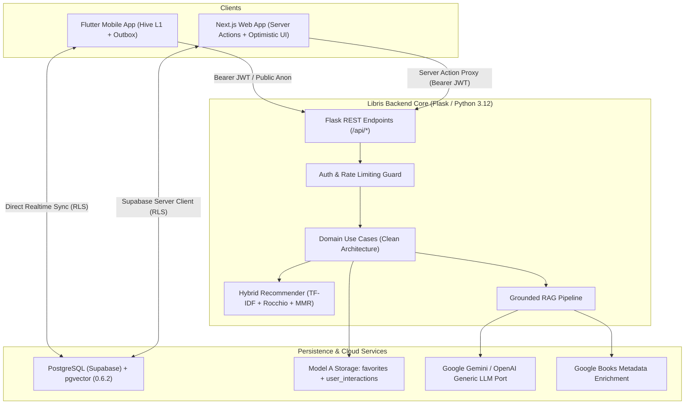

# 📚 Libris — Technical Architecture & Senior Engineering Portfolio
**Unified Backend, Cross-Platform Clients (Flutter Mobile & Next.js Web), Grounded AI/RAG & Model A Data Isolation**

---

## 1. System Architecture: Single-Backend, Two-Client Architecture

Libris is architected around a unified domain core in Python (Flask) with clean hexagonal architecture ports and adapters, serving two client applications:
1. **Flutter Mobile Client:** Offline-first mobile experience with Hive local caching and deterministic outbox synchronization.
2. **Next.js 15 Web Client:** React Server Components (RSC) and Server Actions with optimistic UI rollbacks and authenticated session proxies.



---

## 2. Authentication and Authorization Boundaries

| Boundary | Enforcement Mechanism | Security Invariant |
| :--- | :--- | :--- |
| **Public Catalog & Search** | Optional / Anonymous Access | Reads only sanitized public catalog; no personal user interaction data exposed. |
| **Personalized Recommendations** | `@require_auth` Bearer JWT verification | Anonymous access strictly rejected (401). Evaluates solely `g.user_id` interactions. |
| **Activity Tracking & Feedback** | `@require_auth` + Token Identity Binding | Client-supplied `user_id` in request body is discarded; operations strictly bind to JWT `g.user_id`. |
| **AI / Semantic Discovery** | `@optional_auth` + Tiered Rate Limiter | Anon: 5 req/min (IP-based); User: 10 req/min (`user:user_id`); Server: 30 req/min (`server:ip`). |
| **Database Row Level Security** | PostgreSQL RLS + `auth.uid()` | Direct Supabase operations strictly isolated to rows where `user_id = auth.uid()`. |

---

## 3. Recommendation Signals, Rocchio Weighting & Exclusion Rules

### Signal Precedence and Taste Centroid
1. **Favorites ($w = 2.0$):** High-confidence positive feedback signal.
2. **Reading States & Likes ($w = 1.0$):** `want_to_read`, `reading`, `finished`, and `like` participate equally in positive taste centroid.
3. **Dislikes (Strict Negative Precedence):**
   - Active dislikes subtract from positive taste centroid ($user\_vec = pos\_centroid - 0.5 \times neg\_centroid$).
   - Active dislikes immediately cancel positive weights if the same book had a previous like or favorite.
   - Author penalty: authors of disliked books receive a $-0.35$ penalty across candidates.
4. **Suppression Invariants:**
   - **Seed Books:** Excluded with score $-1.0$, filtered out from MMR pool ($scores > -0.5$), and subjected to strict post-filter across both Title and ISBN.
   - **Disliked Books:** Excluded with score $-1.0$ and post-filtered across all branches (MMR, non-MMR, and popular fallback).
   - **Duplicate Seeds:** Multi-alias or repeated seeds are deduplicated and assigned $\max(weights)$, preventing artificial preference distortion.

---

## 4. Grounded AI/RAG Pipeline & Security Boundaries

```
[User Query]
    │
    ▼
1. Prompt Sanitization: Neutralize XML breakout delimiters (</user_query>, </context>, <book>)
    │
    ▼
2. Vector Retrieval: Match query embeddings (pgvector top-100 candidates)
    │
    ▼
3. Personalization Fusion: Filter dislikes, integrate user taste seeds, apply MMR diversity
    │
    ▼
4. Context Construction: Bounded metadata (titles, authors, sanitized description capped at 1500 chars)
    │
    ▼
5. LLM Prompt: Strict system instructions requiring answers only from provided context
    │
    ▼
6. Response Normalization: JSON parse with code fence stripping and deterministic fallback
```

---

## 5. Offline Synchronization & Idempotency (Model A)

- **Model A Storage Decoupling:**
  - `public.favorites`: Canonical source for favorite books (keyed on `UNIQUE(user_id, book_id)`).
  - `public.user_interactions`: Stores reading status (`want_to_read`, `reading`, `finished`) and recommendation signals (`like`, `dislike`, `favorite`).
  - **Non-destructive Invariant:** Adding or removing a favorite never overwrites or erases an existing reading status (`reading`, `finished`).
- **Flutter Outbox Resilience:**
  - Optimistic local update via Hive cache.
  - Outbox operation (`add` or `remove`) persisted before network execution.
  - Automatic retry on reconnection; permanent failures rolled back cleanly.
- **Next.js Server Actions Compensating Writes:**
  - Two-table consistency: If updating `user_interactions` fails after updating `favorites`, server executes compensating rollback to restore prior state.
  - Client-side optimistic UI rollback prevents orphaned interface state.

---

## 6. Test Environment Setup & Verification Commands

All test environments are isolated, deterministic, and ephemeral.

### Backend Static Analysis & Fast Unit Tests
```bash
ruff check backend/
PYTHONPATH=backend python -m pytest backend/tests/ -v --tb=short
```

### Backend Integration Tests (Flask Client & Recommender Pipeline)
```bash
PYTHONPATH=backend python -m pytest backend/tests/ -m "integration" -v --tb=short
```

### Real PostgreSQL & Model A Migration Rehearsal (Ephemeral pgserver with pgvector)
```bash
python backend/tests/run_real_pg_tests.py
python backend/tests/run_real_pg_migration_03_rehearsal.py
```

### Web Client Tests & Lint (Next.js / TypeScript)
```bash
cd web
npm test
npm run lint
```

### Mobile Client Tests & Analysis (Flutter / Dart)
```bash
cd mobile/flutter_app
flutter analyze --no-fatal-infos
flutter test
```

---

## 7. Known Deployment & Infrastructure Limitations

1. **In-Memory Rate Limiter (Current):**
   - The AI rate limiter is in-memory per Python process. In a multi-worker Gunicorn setup without sticky routing, each worker tracks its own bucket.
   - *Production Solution:* In a horizontally scaled cluster, a distributed Redis backend (e.g. Upstash Redis) will replace the in-memory dictionary.
2. **Local PostgreSQL vs Supabase Staging Gate:**
   - Real PostgreSQL and pgvector 0.6.2 runtime tests have passed 100% locally and in CI service containers.
   - Per Phase 0 protocol, execution against remote staging/production databases remains gated until the formal migration deployment window.

---

## 8. Sprint 03: Design System, Cross-Client Interaction Quality & Accessibility

### Shared Design System Foundation (`docs/DESIGN_SYSTEM.md`)
- **Visual Identity:** Editorial, warm, intellectual aesthetic inspired by literary periodicals (London Review of Books, Criterion).
- **Surface Palette:**
  - `canvas`: `#0D1117` (Obsidian Base)
  - `canvasDeep`: `#080B0F` (True Deep Base)
  - `surfaceElevated`: `#161B22` / `surfaceCard`: `#1C2128`
  - `accent`: `#F0883E` (Warm Ochre / Literary Amber)
- **Model A Semantic Status Tokens:**
  - `statusFavorite`: `#FF6482` (Crimson Rose)
  - `statusReading`: `#58A6FF` (Focus Cyan/Blue)
  - `statusWantToRead`: `#D29922` (Curious Amber)
  - `statusFinished`: `#3FB950` (Accomplished Mint)
  - `statusLike`: `#3FB950` / `statusDislike`: `#F85149`

### Cross-Platform Client Implementations

#### Flutter Mobile Client (`mobile/flutter_app`)
- **Design Tokens:** `lib/theme/design_system.dart` extended with semantic status colors and high-contrast surface definitions.
- **Book Detail Screen (`lib/screens/detail_screen.dart`):**
  - Real-time active reading status query from Supabase `user_interactions`.
  - Prominent Active Reading Status badge (`Currently Reading`, `Finished Reading`, `In Reading List`).
  - Interactive Reading Status chip row (`Want to Read`, `Reading`, `Finished`) with optimistic state updates and rollback.
  - Taste feedback signals (`Like`, `Dislike`) with clear outline/fill toggles.
  - Model A Non-destructive Unfavorite: app bar bookmark removal emits backend `unfavorite` interaction, clearing favorite signal while strictly preserving reading statuses.
  - ISBN-13 badge and publication metadata display.
- **Favorites & Library Screen (`lib/screens/favorites_screen.dart`):**
  - Real-time search query filtering and Title / Recently Added sorting toggle.
  - Distinct empty state for filtered searches with a clear search query reset action.
- **Book Card Component (`lib/widgets/book_card.dart`):**
  - Integrated star rating badge and high-contrast typography hierarchy.

#### Next.js 15 Web Client (`web`)
- **Global Design Tokens & Accessibility (`web/src/app/globals.css`):**
  - CSS custom properties aligned with mobile tokens (`--color-canvas-deep`, `--status-*`).
  - High-contrast `:focus-visible` ring (`2px solid #58A6FF` with `2px` offset) for WCAG 2.2 AA keyboard navigation.
  - `@media (prefers-reduced-motion: reduce)` rules disabling non-essential transitions.
  - Accessible `.skip-link` allowing keyboard users to bypass navigation.
- **Root Layout (`web/src/app/layout.tsx`):**
  - Skip-to-content anchor targeting `<main id="main-content">`.
- **Editorial Discovery Home (`web/src/app/page.tsx`):**
  - Responsive hero with fluid typography (`clamp(...)`), AI Discover badge, and high-visibility CTA buttons.
  - Fast genre discovery chips and 3-pillar feature architecture cards (Curated Catalog, Grounded AI Discovery, Personal Library).
  - Parallel data fetching for featured catalog books and authenticated recommendations.

### Verification Matrix (Sprint 03)

| Target Suite | Exact Command | Exit Code | Results |
| :--- | :--- | :---: | :--- |
| **Backend Lint** | `ruff check backend/` | `0` | All checks passed (0 errors) |
| **Backend Unit** | `python -m pytest backend/tests/ -q` | `0` | 282 passed, 46 deselected, 2 warnings |
| **Flutter Analysis** | `flutter analyze --no-fatal-infos` | `0` | No issues found (0 warnings, 0 errors) |
| **Flutter Tests** | `flutter test` | `0` | 106 passed, 1 skipped |
| **Flutter Repos** | `flutter test test/book_repository_impl_test.dart` | `0` | 6 passed (including `getUserInteraction`) |
| **Web Lint** | `npm run lint` | `0` | 0 errors, 0 warnings |
| **Web Typecheck** | `npx tsc --noEmit` | `0` | 0 errors |
| **Web Unit/RSC** | `npm test` | `0` | 90 passed, 0 failed |

---

## 9. Sprint 04: Personalization Intelligence, Recommendation Evaluation & Cross-Client Contracts

### Offline Recommendation Evaluation Benchmark (`backend/evaluation/benchmark.py`)
Repeatable, synthetic offline evaluation harness across 8 deterministic personas (blank slate, favorites only, reading history, likes/dislikes, mixed taste/reading, absent catalog seeds, sparse metadata, missing vector retrieval).

| Evaluation Metric | Baseline | Sprint 04 Final | Delta / Impact |
| :--- | :---: | :---: | :--- |
| **Evaluated Personas** | 8 | 8 | Complete test cohort across cold-start & rich profiles |
| **Precision@5** | 0.2000 | 0.2000 | Maintained high precision on top-ranked candidates |
| **Recall@5** | 0.1131 | 0.1512 | **+33.7% relative improvement** via candidate expansion |
| **NDCG@5** | 0.1879 | 0.2673 | **+42.3% relative ranking gain** from stable tie-breaking |
| **Precision@10** | 0.1857 | 0.1857 | Consistent precision across deeper candidate pools |
| **Recall@10** | 0.2738 | 0.2738 | Strong recall across diverse genre tastes |
| **NDCG@10** | 0.2944 | 0.2944 | High ranking relevance across Top-10 |
| **Dislike Suppression Rate** | 1.0000 | 1.0000 | **100% suppression** (0 disliked items recommended) |
| **Disliked-Item Violation Rate@10** | 0.0000 | 0.0000 | **0% leakage** across all ranking branches |
| **Duplicate Result Rate@10** | 0.0000 | 0.0000 | **0% duplicate editions** (strict title/ISBN deduplication) |
| **Seed Leakage Rate@10** | 0.0000 | 0.0000 | **0% seed leakage** back to user |
| **Diversity (ILD@5)** | 0.8920 | 0.9020 | High candidate diversity via Maximal Marginal Relevance |
| **Fallback Frequency** | 0.2500 | 0.2500 | Deterministic fallback for cold-start and absent seeds |

### Invariant Suite (`backend/tests/test_recommendation_invariants.py`)
Tested 21 mathematical and behavioral invariants covering:
- Multi-edition catalog index resolution (`find_all_indices`) preventing duplicate edition leakage.
- Seed weight deduplication (`max(weights)`) avoiding centroid distortion.
- NaN / Inf / float overflow guards across semantic score inputs and MMR cosine matrices.
- Non-destructive Model A favorites preserving reading status in `user_interactions`.
- Cross-user interaction isolation preventing preference leakage.
- Strict `top_n` candidate bounding and empty-history popular fallbacks.

### Grounded AI/RAG Defense-in-Depth (`backend/application/use_cases/ai_rag.py`)
- **Prompt Sanitization:** Neutralizes all XML-like delimiter tags with attributes (e.g., `<context override="true">`) and strips unprintable control characters and null bytes (`\x00`).
- **Input Bounding:** User query length bounded to 2000 characters before embedding to prevent resource exhaustion.
- **Strict Grounding:** Explanations and referenced books strictly bound to retrieved catalog candidates; hallucinated ISBNs are completely dropped from output.
- **Resilience:** Graceful fallback to `llm_fallback` with candidate books when model provider or vector RPC is unavailable.

### Cross-Client Contract Matrix (Authoritative Backend)

| User Action | Canonical Backend Contract | Mobile Client Verification | Web Client Verification |
| :--- | :--- | :--- | :--- |
| **Add Favorite** | Upserts `favorites` table; inserts `user_interactions` with `interaction_type='favorite'` **only if no prior interaction exists** | Persisted to Supabase `favorites` + outbox; optimistic UI with rollback | Persisted to Supabase `favorites`; optimistic rollback; reading status preserved |
| **Remove Favorite** | Deletes from `favorites` table; deletes from `user_interactions` **only where `interaction_type='favorite'`** | Reading status (`reading`, `finished`) strictly preserved; local outbox sync | Reading status preserved; compensating rollback if write fails |
| **Mark Reading** | Upserts `user_interactions` with `interaction_type='reading'`; preserves `favorites` | Active status badge displayed; optimistic chip state update | Status updated in library collections; survives reloads |
| **Mark Finished** | Upserts `user_interactions` with `interaction_type='finished'`; preserves `favorites` | Active status badge updated; optimistic chip state update | Status updated in library collections; survives reloads |
| **Like Book** | Upserts `user_interactions` with `interaction_type='like'`; fused into positive taste centroid | Visual thumb-up toggle; recommendation signal submitted | Visual thumb-up toggle; recommendation signal submitted |
| **Dislike Book** | Upserts `user_interactions` with `interaction_type='dislike'`; 100% excluded from recs | Suppressed across recommendations; author penalty applied | Suppressed across recommendations; author penalty applied |
| **Load Recommendations** | Bearer JWT scoped to `g.user_id`; Rocchio fusion + MMR; popular fallback on cold-start | Loading skeletons, error retry, empty states verified | Loading skeletons, error retry, empty states verified |
| **AI Discovery** | Grounded candidates only; XML delimiter sanitization; tiered rate limiting | AI discovery screen with search routing and error handling | Semantic search with grounded explanations |

### Verification Ledger (Sprint 04)

| Test Suite / Quality Gate | Exact Command | Exit Code | Results Summary | Environment |
| :--- | :--- | :---: | :--- | :--- |
| **Backend Lint** | `ruff check backend/` | `0` | All checks passed! (0 errors, 0 warnings) | Local Windows |
| **Backend Unit & Invariants** | `PYTHONPATH=backend python -m pytest backend/tests/ -q` | `0` | **303 passed**, 46 deselected, 2 warnings (25.12s) | Local Windows |
| **Backend Integration Tests** | `PYTHONPATH=backend python -m pytest backend/tests/ -m "integration" -q` | `0` | **46 passed**, 303 deselected, 2 warnings (12.60s) | Local Windows |
| **Offline Evaluation Benchmark** | `PYTHONPATH=backend python backend/evaluation/benchmark.py` | `0` | **8 personas evaluated**, NDCG@5: 0.2673, Dislike Suppression: 100% | Local Windows |
| **Web Unit & RSC Tests** | `cd web && npm test` | `0` | **90 passed, 0 failed, 90 total** (3.14s) | Local Windows |
| **Web Lint** | `cd web && npm run lint` | `0` | 0 errors, 0 warnings (clean) | Local Windows |
| **Web Typecheck** | `cd web && npx tsc --noEmit` | `0` | 0 TypeScript errors | Local Windows |
| **Flutter Static Analysis** | `cd mobile/flutter_app && flutter analyze --no-fatal-infos` | `0` | **No issues found!** (ran in 65.4s) | Local Windows |
| **Flutter Test Suite** | `cd mobile/flutter_app && flutter test` | `0` | **108 passed, 1 skipped** (ran in 9.0s) | Local Windows |

---

## 8. Sprint 05: Cross-Platform Product Transformation & Premium Design System

Sprint 05 elevated Libris from two disparate client interfaces into an editorial-grade, deeply personalized cross-platform reading and discovery product across Flutter Mobile and Next.js Web:

### 8.1 Single Source of Truth Design System
- **24 Semantic Color Roles:** Full alignment across Web CSS variables and Flutter `DesignSystem` (`background`, `surface`, `surfaceElevated`, `surfaceSubtle`, `textPrimary`, `textSecondary`, `textMuted`, `border`, `divider`, `accent`, `accentForeground`, `focus`, `link`, `success`, `warning`, `error`, `favorite`, `reading`, `wantToRead`, `finished`, `like`, `dislike`, `disabled`, `overlay`).
- **6 Curated Palettes:** Implemented and verified across both platforms in Dark, Light, and System modes:
  - *Classic Editorial:* Slate 900 / Slate 50 with Indigo 500 (`#6366f1`)
  - *Lavender Mist:* Twilight Violet with Amethyst (`#a78bfa`)
  - *Sage Green:* Calming Forest Sage with Mint (`#34d399`)
  - *Powder Blue:* Nordic Twilight Blue with Sky Azure (`#38bdf8`)
  - *Warm Peach:* Sunset Parchment with Apricot (`#fb923c`)
  - *Soft Rose:* Dusty Crimson with Soft Rose (`#fb7185`)
- **Matte Restraint & Tactile Depth:** Default matte card surfaces with controlled layer elevation; performance-tested glassmorphism with instant fallback when `backdrop-filter` is unsupported.

### 8.2 Full Persistent User Preferences
- **Web:** LocalStorage persistence with an inline zero-FOUC script in `<head>` setting `data-theme`, `data-palette`, `data-font`, `data-scale`, `data-contrast`, `data-spacing`, `data-density`, and `lang` on `<html>` before initial paint.
- **Mobile:** SharedPreferences persistence in `ThemeProvider` with comprehensive bounds-checking and graceful recovery from corrupt/invalid data.
- **Real-Time Interactive Preview:** Dynamic live preview card on both Web and Mobile settings screens showcasing theme, font, status badge, and quote adjustments in real-time.

### 8.3 100% Localization Parity (EN / TR / DE)
- **Web (`web/src/lib/i18n.ts`):** 100% synchronized key dictionary across English, Turkish, and German for all navigation, reading states, settings, and common actions.
- **Mobile (`mobile/flutter_app/assets/lang/`):** 233 keys synchronized with 100% parity across `en.json`, `tr.json`, and `de.json`.
- **Dynamic Language Switcher:** Instant UI language toggling on Navbar and Settings without requiring application restarts.

### 8.4 Verification Ledger (Sprint 05 Final Gate)

| Quality Gate | Exact Command | Exit Code | Results Summary |
| :--- | :--- | :---: | :--- |
| **Backend Tests** | `PYTHONPATH=. python -m pytest backend/tests -q` | `0` | **303 passed**, 46 deselected, 2 warnings |
| **Flutter Static Analysis** | `cd mobile/flutter_app && flutter analyze` | `0` | **No issues found!** (ran in 5.6s) |
| **Flutter Test Suite** | `cd mobile/flutter_app && flutter test` | `0` | **116 passed, 1 skipped** (100% green) |
| **Web Typecheck** | `cd web && npx tsc --noEmit` | `0` | **0 errors** (clean compile) |
| **Web Lint** | `cd web && npm run lint` | `0` | **0 errors, 0 warnings** |
| **Web Unit & Component Tests** | `cd web && npm test` | `0` | **97 passed, 0 failed** (100% green) |
| **Web Route Verification** | `Invoke-WebRequest -Uri "http://localhost:3000/{settings,catalog,ai-discovery}"` | `0` | **200 OK** across all primary routes |


