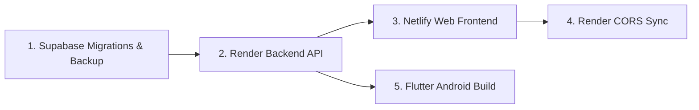

# Libris V1 — Deployment Execution Checklist

This document is the canonical, repository-specific deployment guide for launching the **Libris V1 Public Beta**. It establishes verified configuration settings, database migration procedures, environment variable requirements, and smoke tests across all tiers.

---

## 1. Verified Repository & Architecture Baseline

| Component | Target Platform / Tier | Source Code Directory | Key Framework / Runtime |
| :--- | :--- | :--- | :--- |
| **Backend API** | Render (Free Tier) | [`backend/`](file:///c:/Users/akifk/Desktop/book-ai-app/backend) | Python 3.12 / Flask / Gunicorn |
| **Web Client** | Netlify (Free Tier) | [`web/`](file:///c:/Users/akifk/Desktop/book-ai-app/web) | Next.js 16 (Turbopack, Server Actions) |
| **Database & Auth** | Supabase (PostgreSQL 15+) | [`backend/scripts/`](file:///c:/Users/akifk/Desktop/book-ai-app/backend/scripts) | PostgreSQL + `pgvector` (`>= 0.7.0`) |
| **Mobile App** | Android Release APK | [`mobile/flutter_app/`](file:///c:/Users/akifk/Desktop/book-ai-app/mobile/flutter_app) | Flutter 3.24.3 / Dart |

- **Baseline Commit:** [`6dbac4b638241c40469f6c74655a3dc2f9b1005c`](file:///c:/Users/akifk/Desktop/book-ai-app) (`main`).
- **CI Status:** 100% passing across all 6 validation pipelines (Docker build, backend tests, web build & lint, mobile analysis, migration validation).

---

## 2. Service-by-Service Setup Sequence

To avoid deployment dependency deadlocks, execute services in this exact order:



1. **Step 1: Supabase Database Verification & Migration**
   - Verify `pgvector` version (`>= 0.7.0`).
   - Run backup (if existing user data exists).
   - Apply migrations `00_init_books.sql` through `08_user_profiles_and_activities.sql`.
   - Seed book catalog if starting from fresh.
2. **Step 2: Deploy Flask Backend on Render Free**
   - Create Web Service from GitHub repository.
   - Configure environment variables and health check path.
   - Verify boot, memory usage, and health probe response.
3. **Step 3: Deploy Next.js Web on Netlify Free**
   - Connect repository with Base Directory `web`.
   - Configure environment variables pointing to live Render backend.
   - Trigger build and obtain public subdomain (`https://<site-name>.netlify.app`).
4. **Step 4: Synchronize Backend CORS**
   - In Render dashboard, add the Netlify URL to `ALLOWED_ORIGINS`.
5. **Step 5: Compile Flutter Android APK**
   - Run `flutter build apk --release` with compile-time `--dart-define` parameters pointing to the live Render and Supabase URLs.

---

## 3. Verified Provider Settings

### A. Netlify Web Deployment (Next.js 16)
- **Repository Connection:** `akifkeklik/book-ai-app`
- **Base Directory:** `web`
- **Package Directory:** `web` (automatically resolved)
- **Build Command:** `npm run build`
- **Publish Directory:** `.next`
- **Framework Detection:** Netlify automatically detects Next.js and utilizes its official `@netlify/plugin-nextjs` runtime. No custom configuration file (`netlify.toml`) is required.
- **Node.js Version:** Set environment variable `NODE_VERSION=22` in the Netlify site configuration to match the Node 22 runtime verified in CI.
- **Server Execution Context:** All calls in [`web/src/lib/api.ts`](file:///c:/Users/akifk/Desktop/book-ai-app/web/src/lib/api.ts) originate from React Server Components or Server Actions (`'use server'`). The browser never sees `LIBRIS_API_KEY` or calls the backend directly; requests flow server-to-server over HTTPS.

### B. Render Backend Deployment (Flask / Gunicorn)
- **Service Type:** Web Service (Free Tier)
- **Repository Connection:** `akifkeklik/book-ai-app`
- **Root Directory:** `backend`
- **Runtime Choice:**
  - **Option 1 (Recommended & Verified - Container):** `Docker`. Render uses [`backend/Dockerfile`](file:///c:/Users/akifk/Desktop/book-ai-app/backend/Dockerfile). Build context is `backend`. This matches the multi-stage Python 3.12 container verified in CI.
  - **Option 2 (Native Python):** `Python 3`. Build command: `pip install -r requirements.txt`.
    > [!WARNING]
    > In `backend/app.py`, package-relative imports (`from .config import ...`) are used. Invoking `gunicorn app:app` from within the `backend` directory fails with `ImportError: attempted relative import with no known parent package`. If using Root Directory `backend`, the start command must expose the parent package:
    ```bash
    PYTHONPATH=.. gunicorn backend.app:app --bind 0.0.0.0:$PORT --workers 1 --preload --timeout 120
    ```
    Also note that [`backend/runtime.txt`](file:///c:/Users/akifk/Desktop/book-ai-app/backend/runtime.txt) specifies `python-3.11.8` for Render native Python builds. Option 1 (Docker with Python 3.12) is strongly recommended for CI environment parity.
- **Health Check Path:** `/api/health`
  > [!IMPORTANT]
  > Do **not** set Render's health check path to `/api/health/ready`. `/api/health` is a pure HTTP liveness probe that returns immediately without querying Supabase. Using `/api/health/ready` could cause false-positive deploy cancellations if Supabase has cold-start latency.
- **Memory & Resource Budget:**
  - *Measured Allocation:* Active app with loaded TF-IDF model ([`backend/saved_model/tfidf.pkl`](file:///c:/Users/akifk/Desktop/book-ai-app/backend/saved_model/tfidf.pkl)) consumes ~106 MB allocated, ~180 MB RSS.
  - *Free Tier Cap:* 512 MB RAM. Single worker with `--preload` fits comfortably with >50% headroom.
- **Render Free Operational Constraints:**
  1. **Idle Sleep:** Spins down after **15 minutes of inactivity**.
  2. **Cold Starts:** First request to a sleeping instance takes **50–90 seconds**.
  3. **Ephemeral Storage:** The container disk is non-persistent. Pre-trained models must be checked into Git (as `saved_model/tfidf.pkl` is). Retraining at runtime is lost on restart.
  4. **Workspace Hour Limit:** Render provides 750 free instance hours/month per workspace. Running a second free web service for the frontend would exhaust hours by mid-month. Keep Web exclusively on Netlify.

---

## 4. Environment Variables Matrix & Secret Generation

### A. How to Generate Required Cryptographic Secrets Locally
Generate secure 256-bit random hex strings on your workstation:
```bash
# Using Python:
python -c "import secrets; print(secrets.token_hex(32))"

# Or using OpenSSL:
openssl rand -hex 32
```
Generate two distinct tokens:
1. One for `SECRET_KEY` (Flask session signing)
2. One for `LIBRIS_API_KEY` (Server-to-server API authentication)

### B. Variable Configuration Matrix

| Variable Name | Service Tier | Secret? | Destination Console | Example / Format | Behavior if Missing / Invalid |
| :--- | :--- | :--- | :--- | :--- | :--- |
| `SECRET_KEY` | Backend | **Yes** | Render Environment | `64-char hex string` | **Fatal Boot Crash**: `ValueError` thrown in [`backend/app.py:L42`](file:///c:/Users/akifk/Desktop/book-ai-app/backend/app.py#L42) when running in production mode. |
| `LIBRIS_API_KEY` | Backend | **Yes** | Render Environment | `libris_sec_...` | **Degraded Service**: Protected `/api/*` endpoints return `503 Server misconfigured`. |
| `NUM_PROXIES` | Backend | No | Render Environment | `1` | Defaults to `1` in production for Render reverse proxy trust. |
| `LLM_PROVIDER` | Backend | No | Render Environment | `gemini` | Defaults to `gemini` (`openai` also supported). |
| `LLM_API_KEY` | Backend | **Yes** | Render Environment | `AIzaSy...` (Gemini API key) | RAG assistant falls back to catalog recommendations without failing. |
| `GEMINI_API_KEY` | Backend | **Yes** | Render Environment | `AIzaSy...` | Required if `LLM_PROVIDER=openai` for 3072-dim embeddings. |
| `GOOGLE_BOOKS_API_KEY` | Backend | **Yes** | Render Environment | `AIzaSy...` | Optional; falls back to catalog CSV thumbnail URLs. |
| `SUPABASE_URL` | Backend | No | Render Environment | `https://<ref>.supabase.co` | Supabase features disabled; `/api/health/ready` fails. |
| `SUPABASE_ANON_KEY` | Backend | No (Public JWT) | Render Environment | `eyJhbGciOi...` | Supabase client initialization fails. |
| `ALLOWED_ORIGINS` | Backend | No | Render Environment | `https://<site>.netlify.app` | Browser blocks cross-origin requests. |
| `TOP_N_RECOMMENDATIONS` | Backend | No | Render Environment | `10` | Defaults to `10`. |
| `NODE_VERSION` | Web | No | Netlify Environment | `22` | Ensures build runtime parity with Next.js 16. |
| `BACKEND_URL` | Web | No | Netlify Environment | `https://<app>.onrender.com` | Defaults to `localhost:5000` (Server Actions fail). |
| `LIBRIS_API_KEY` | Web | **Yes** | Netlify Environment | `libris_sec_...` (matches Backend) | Backend returns `401 Unauthorized` on server requests. |
| `NEXT_PUBLIC_SUPABASE_URL` | Web | No | Netlify Environment | `https://<ref>.supabase.co` | Browser client authentication fails. |
| `NEXT_PUBLIC_SUPABASE_ANON_KEY` | Web | No (Public JWT) | Netlify Environment | `eyJhbGciOi...` | Browser client authentication fails. |
| `BACKEND_URL` | Mobile | No | `--dart-define` flag | `https://<app>.onrender.com` | **Fatal Launch Crash**: Throws `StateError` on release launch. |
| `SUPABASE_URL` | Mobile | No | `--dart-define` flag | `https://<ref>.supabase.co` | **Fatal Launch Crash**: Throws `StateError` on release launch. |
| `SUPABASE_ANON_KEY` | Mobile | No (Public JWT) | `--dart-define` flag | `eyJhbGciOi...` | **Fatal Launch Crash**: Throws `StateError` on release launch. |
| `SUPABASE_DB_URL` | Local Dev / Scripts | **Yes** | Local workstation only | `postgresql://postgres:<pw>@aws-0-<region>.pooler.supabase.com:6543/postgres` | Required only when running developer scripts ([`backend/scripts/backfill_embeddings.py`](file:///c:/Users/akifk/Desktop/book-ai-app/backend/scripts/backfill_embeddings.py)). **Never** commit to Git or add to Render/Netlify console. |

> [!CAUTION]
> **Strict `service_role` Secret Isolation:**
> - The Supabase `service_role` key grants complete administrative bypass over all Row Level Security (RLS) policies.
> - **NEVER** configure `service_role` in Netlify environment variables (`NEXT_PUBLIC_SUPABASE_ANON_KEY`), mobile builds (`--dart-define SUPABASE_ANON_KEY`), or Render backend environment variables. Exposing it to Netlify or Flutter exposes full database control directly to end users and browsers.
> - Use `service_role` exclusively within a private local terminal session for initial one-off catalog seeding, and ensure it is never persisted to files or version control.

---

## 5. Database Backup, Migration & Seeding Runbook

### Pre-requisite Check: PostgreSQL Extension
In Supabase SQL Editor, verify that the `pgvector` extension version supports `halfvec(3072)`:
```sql
SELECT extname, extversion FROM pg_extension WHERE extname = 'vector';
```
*Requirement:* `extversion` must be `>= 0.7.0`.

---

### Procedure A: Existing Database Containing User Data

#### 1. Mandatory Logical Backup
Before executing any DDL on a live database, take a full snapshot:
```bash
# Option A: Direct PostgreSQL connection (requires IPv6 support on client workstation)
pg_dump -h db.<project-ref>.supabase.co -U postgres -d postgres -F p -f pre_v1_backup.sql

# Option B: Via Supabase Connection Pooler (recommended for standard IPv4 networks)
pg_dump -h aws-0-<region>.pooler.supabase.com -p 6543 -U postgres.<project-ref> -d postgres -F p -f pre_v1_backup.sql

# Option C: Via Supabase CLI (if logged in)
supabase db dump -f pre_v1_backup.sql
```
Verify that the backup file is non-empty and readable.

#### 2. Apply Migrations Sequentially
Execute each file in the Supabase SQL Editor in exact order:
1. [`00_init_books.sql`](file:///c:/Users/akifk/Desktop/book-ai-app/backend/scripts/00_init_books.sql): Creates base tables; renames `favorites.isbn13` to `book_id` if needed; ensures `book_author` and `book_image_url` exist.
2. **Execute Legacy Favorites Reconciliation & Thumbnail Backfill (Conditional):**
   If migrating an existing database where `favorites` was created under an earlier schema (which may lack `book_title` or stored thumbnails in `thumbnail`):
   ```sql
   DO $$
   BEGIN
       -- 1. Ensure book_title column exists (required by Next.js SSR and Flutter upsert)
       IF NOT EXISTS (
           SELECT 1 FROM information_schema.columns
           WHERE table_schema = 'public' AND table_name = 'favorites' AND column_name = 'book_title'
       ) THEN
           ALTER TABLE public.favorites ADD COLUMN book_title TEXT NOT NULL DEFAULT '';
       END IF;

       -- 2. Backfill title if legacy schema used 'title'
       IF EXISTS (
           SELECT 1 FROM information_schema.columns
           WHERE table_schema = 'public' AND table_name = 'favorites' AND column_name = 'title'
       ) THEN
           UPDATE public.favorites
           SET book_title = title
           WHERE (book_title IS NULL OR book_title = '')
             AND title IS NOT NULL AND title <> '';
       END IF;

       -- 3. Backfill thumbnail if legacy schema used 'thumbnail'
       IF EXISTS (
           SELECT 1 FROM information_schema.columns
           WHERE table_schema = 'public' AND table_name = 'favorites' AND column_name = 'thumbnail'
       ) AND EXISTS (
           SELECT 1 FROM information_schema.columns
           WHERE table_schema = 'public' AND table_name = 'favorites' AND column_name = 'book_image_url'
       ) THEN
           UPDATE public.favorites
           SET book_image_url = thumbnail
           WHERE (book_image_url IS NULL OR book_image_url = '')
             AND thumbnail IS NOT NULL AND thumbnail <> '';
       END IF;
   END $$;
   ```
3. [`01_schema.sql`](file:///c:/Users/akifk/Desktop/book-ai-app/backend/scripts/01_schema.sql): Creates `user_interactions`. (If re-running on an existing table with policies, run first: `DROP POLICY IF EXISTS "Users can view their own interactions" ON public.user_interactions; DROP POLICY IF EXISTS "Users can insert their own interactions" ON public.user_interactions;`).
4. [`02_phase3_migration.sql`](file:///c:/Users/akifk/Desktop/book-ai-app/backend/scripts/02_phase3_migration.sql): Deduplicates interactions, adds unique constraint, sync trigger `trg_sync_favorites`. Fully idempotent.
5. [`03_phase3_embeddings.sql`](file:///c:/Users/akifk/Desktop/book-ai-app/backend/scripts/03_phase3_embeddings.sql): Creates `book_embeddings` with `halfvec(3072)` HNSW index. (If re-running on an existing table with policies, run first: `DROP POLICY IF EXISTS "Embeddings are readable by everyone" ON public.book_embeddings;`).
6. [`04_phase3_hybrid.sql`](file:///c:/Users/akifk/Desktop/book-ai-app/backend/scripts/04_phase3_hybrid.sql): Creates base `match_book_embeddings` RPC. Fully idempotent.
7. [`05_phase3_performance.sql`](file:///c:/Users/akifk/Desktop/book-ai-app/backend/scripts/05_phase3_performance.sql): Optimizes `match_book_embeddings` RPC for HNSW halfvec traversal. Fully idempotent.
8. [`06_phase2_rag.sql`](file:///c:/Users/akifk/Desktop/book-ai-app/backend/scripts/06_phase2_rag.sql): Creates `match_query_embeddings` RPC. Fully idempotent.
9. [`07_phase3_collections.sql`](file:///c:/Users/akifk/Desktop/book-ai-app/backend/scripts/07_phase3_collections.sql): Expands interaction type constraints. Fully idempotent.
10. [`08_user_profiles_and_activities.sql`](file:///c:/Users/akifk/Desktop/book-ai-app/backend/scripts/08_user_profiles_and_activities.sql): Creates `user_profiles` and `user_activities` tables with RLS. Fully idempotent.

---

### Procedure A.1: Production Database Hardening & Reconciliation (Live Deployment)

For live production execution, the four audited hardening migrations in [`backend/scripts/hardening/`](file:///c:/Users/akifk/Desktop/book-ai-app/backend/scripts/hardening) supersede ad-hoc script execution:
1. **Preflight Audit:** Execute [`backend/scripts/preflight_database_hardening.sql`](file:///c:/Users/akifk/Desktop/book-ai-app/backend/scripts/preflight_database_hardening.sql) (Section 12 single-shot summary query).
2. **Grup 1 (Privilege Hardening):** [`01_DRAFT_revoke_dangerous_privileges.sql`](file:///c:/Users/akifk/Desktop/book-ai-app/backend/scripts/hardening/01_DRAFT_revoke_dangerous_privileges.sql).
3. **Grup 2 (Profiles Staged Reconciliation):** [`02_DRAFT_reconcile_user_profiles.sql`](file:///c:/Users/akifk/Desktop/book-ai-app/backend/scripts/hardening/02_DRAFT_reconcile_user_profiles.sql).
4. **Grup 3 (Model A Interactions & Lossless Deduplication):** [`03_DRAFT_reconcile_interactions_and_trigger.sql`](file:///c:/Users/akifk/Desktop/book-ai-app/backend/scripts/hardening/03_DRAFT_reconcile_interactions_and_trigger.sql).
5. **Grup 4 (Vector RPC Hardening):** [`04_DRAFT_harden_vector_rpcs.sql`](file:///c:/Users/akifk/Desktop/book-ai-app/backend/scripts/hardening/04_DRAFT_harden_vector_rpcs.sql).

---

### Procedure B: Fresh Database Setup & Catalog Seeding

1. Execute SQL scripts [`00_init_books.sql`](file:///c:/Users/akifk/Desktop/book-ai-app/backend/scripts/00_init_books.sql) through [`08_user_profiles_and_activities.sql`](file:///c:/Users/akifk/Desktop/book-ai-app/backend/scripts/08_user_profiles_and_activities.sql) in numerical order.
2. **Catalog Ingestion Analysis & Execution:**
   - Script: [`backend/scripts/upload_books_to_supabase.py`](file:///c:/Users/akifk/Desktop/book-ai-app/backend/scripts/upload_books_to_supabase.py)
   - *Code Behavior:* Reads [`backend/data/books.csv`](file:///c:/Users/akifk/Desktop/book-ai-app/backend/data/books.csv) (6,448 titles) and performs `supabase.table("books").upsert(batch)` keyed on primary key `isbn13`.
   - *Rerun Safety:* **Safe on empty database.** On an existing database, it will NOT duplicate rows or delete records, but it **will overwrite any manually enriched book metadata** with raw CSV data.
   - *RLS Prerequisite:* `public.books` only permits `SELECT` for anonymous users. The ingestion script **must** be executed with `SUPABASE_SERVICE_ROLE_KEY` to bypass RLS.
   - *Execution Hygiene:* Because `backend/config.py` loads `backend/.env` with `override=True`, never store `service_role` in `backend/.env`. Pass it as a one-time environment variable to the process:
   ```bash
   # Linux / macOS / Git Bash:
   SUPABASE_URL="https://<ref>.supabase.co" SUPABASE_SERVICE_ROLE_KEY="<SERVICE_ROLE_KEY>" python backend/scripts/upload_books_to_supabase.py

   # Windows PowerShell:
   $env:SUPABASE_URL="https://<ref>.supabase.co"; $env:SUPABASE_SERVICE_ROLE_KEY="<SERVICE_ROLE_KEY>"; python backend/scripts/upload_books_to_supabase.py; Remove-Item env:SUPABASE_SERVICE_ROLE_KEY

   # Remove local execution log if generated
   rm -f upload_log.txt
   ```
3. **Optional Semantic Embedding Pre-computation:**
   - Script: [`backend/scripts/backfill_embeddings.py`](file:///c:/Users/akifk/Desktop/book-ai-app/backend/scripts/backfill_embeddings.py)
   - Connects via direct PostgreSQL connection string `SUPABASE_DB_URL` (use pooler port 6543 on IPv4 networks).
   - Idempotent: checks SHA-256 `content_hash` against existing rows and skips already computed embeddings.
   ```bash
   SUPABASE_DB_URL="postgresql://postgres.<ref>:<pw>@aws-0-<region>.pooler.supabase.com:6543/postgres" \
   GEMINI_API_KEY="<AIzaSy...>" \
   python backend/scripts/backfill_embeddings.py --batch-size 100
   ```

---

## 6. Post-Deployment Verification (Smoke Tests)

Run these checks against your deployed endpoints:

```bash
# 1. Backend Liveness Check (Render wakes up)
curl -f https://<backend-app>.onrender.com/api/health
# Expected: {"service":"book-ai-api","status":"healthy"} (HTTP 200)

# 2. Backend Deep Readiness Check (Verifies Supabase connectivity)
curl -f https://<backend-app>.onrender.com/api/health/ready
# Expected: {"service":"book-ai-api","status":"ready"} (HTTP 200)

# 3. Catalog Fetch via Server API Key
curl -f -H "X-Api-Key: <LIBRIS_API_KEY>" \
  "https://<backend-app>.onrender.com/api/books?page=1&per_page=5"
# Expected: JSON response containing 5 books with normalized fields

# 4. RAG AI Assistant Test
curl -X POST -H "Content-Type: application/json" -H "X-Api-Key: <LIBRIS_API_KEY>" \
  -d '{"query":"fast paced science fiction"}' \
  "https://<backend-app>.onrender.com/api/ai/chat"
# Expected: HTTP 200 with {"answer":"...","referenced_books":[...],"status":"success"}

# 5. In-Memory Rate Limiting Enforcement
# Protected endpoints require authentication in production. Use SUPABASE_ANON_KEY to exercise the anonymous bucket (limit: 5 req/min):
for i in {1..7}; do
  curl -s -o /dev/null -w "%{http_code}\n" -X POST \
    -H "Content-Type: application/json" \
    -H "Authorization: Bearer <SUPABASE_ANON_KEY>" \
    -d '{"query":"ping"}' "https://<backend-app>.onrender.com/api/ai/chat"
done
# Expected: First 5 requests return 200; 6th and 7th return 429 Too Many Requests (with Retry-After header)

# 6. Web Frontend Functional Navigation
# - Visit https://<site>.netlify.app/ (Hero and popular books load)
# - Visit https://<site>.netlify.app/catalog (Search and filter controls functional)
# - Visit https://<site>.netlify.app/favorites (Unauthenticated session redirects via Next.js 16 proxy to /login?redirect=%2Ffavorites)
```

> [!TIP]
> **Cold-Start Pre-warming Requirement:**
> Netlify Free Tier serverless functions have a 10-second execution timeout. Because sleeping Render Free instances take 50–90 seconds to cold boot, always run Smoke Test 1 (`/api/health`) first and wait for an HTTP 200 response before navigating to the Netlify Web frontend (Test 6) or triggering Server Actions.

---

## 7. Rollback & Recovery Plan

1. **Web Frontend (Netlify):**
   - In Netlify Dashboard under **Deploys**, click on the previous successful deploy and select **"Publish deploy"** for instant zero-downtime rollback.
2. **Backend API (Render):**
   - In Render Dashboard under **Events**, click the prior commit deployment and trigger a manual redeploy.
3. **Database Schema & Trigger:**
   - Because all Batch 1–3 migrations are additive, code rollback does not necessitate rolling back the PostgreSQL schema.
   - If rolling back backend code to an earlier revision that does not support automatic favorites syncing, disable the database trigger:
     ```sql
     DROP TRIGGER IF EXISTS trg_sync_favorites ON public.favorites;
     DROP FUNCTION IF EXISTS sync_favorites_to_interactions();
     ```
4. **Full Database Disaster Recovery:**
   - If schema corruption occurs, restore the verified pre-migration logical backup:
     ```bash
     psql -h db.<project-ref>.supabase.co -U postgres -d postgres -f pre_v1_backup.sql
     ```

---

## 8. Launch Gates & Acceptance Criteria

Do not invite public beta testers until every gate is verified:

- [ ] **Gate A (Database):** Migrations 00–08 applied; `pgvector` version confirmed `>= 0.7.0`; catalog books count `>= 6,000`.
- [ ] **Gate B (Backend):** Render Web Service deployed; steady-state memory `< 250 MB`; `/api/health` and `/api/health/ready` return 200.
- [ ] **Gate C (Web):** Netlify deployment active; Next.js 16 SSR and Server Actions execute without browser console errors.
- [ ] **Gate D (CORS):** Netlify origin configured in Render `ALLOWED_ORIGINS`.
- [ ] **Gate E (Auth & Sync):** User registration and login succeed; adding a favorite records in `favorites` and triggers synchronization into `user_interactions`.
- [ ] **Gate F (Mobile):** Android APK built with valid `--dart-define` parameters boots without `StateError` and connects to live services.
- [ ] **Gate G (Security):** No raw credentials committed to Git or printed in client logs; production `SECRET_KEY` and `LIBRIS_API_KEY` active.
