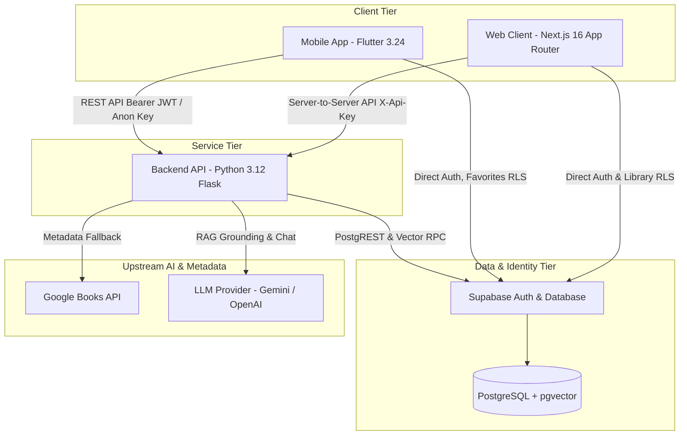

# Libris V1 — Operational Runbook & Release Readiness Guide

## 1. System Architecture & Component Map

Libris V1 is a multi-tier, cross-platform intelligent book discovery application composed of:



### Component Details
1. **Web Frontend (`web/`)**: Next.js 16 (Turbopack, Partial Prerendering, `@supabase/ssr`, `proxy.ts` middleware), Vanilla CSS tokens, Server Actions for library management.
2. **Mobile Frontend (`mobile/flutter_app/`)**: Flutter 3.24, Provider state management, GoRouter, `supabase_flutter`.
3. **Backend Service (`backend/`)**: Python 3.12 Flask, TF-IDF + Cosine Similarity recommendation engine, Rocchio feedback loop, RAG vector retrieval, tiered rate limiting, structured JSON logging.
4. **Data & Auth Tier**: Supabase PostgreSQL with `pgvector` extension, Row-Level Security (RLS) on all user-scoped tables (`user_interactions`, `user_profiles`, `user_activities`, `favorites`).

---

## 2. Environment Configuration & Secrets Management

Each tier contains dedicated environment templates:
- **Backend**: `backend/env.example` -> `backend/.env`
- **Web**: `web/.env.example` -> `web/.env.local`
- **Mobile**: `mobile/flutter_app/env.example` -> Compile-time `--dart-define` parameters

### Required Environment Variables

| Variable | Tier | Description | Production Requirement |
| :--- | :--- | :--- | :--- |
| `SECRET_KEY` | Backend | Flask session cryptographic secret | Long random string |
| `LIBRIS_API_KEY` | Backend / Web | Shared secret for server-to-server endpoints | Secure random token |
| `LLM_PROVIDER` | Backend | LLM engine (`gemini` or `openai`) | `gemini` (default) |
| `LLM_API_KEY` | Backend | API key for Gemini 2.5 or OpenAI | Valid provider key |
| `GOOGLE_BOOKS_API_KEY`| Backend | Book cover and metadata enrichment | Optional fallback |
| `SUPABASE_URL` | Backend / Web / Mobile | Supabase project HTTPS URL | Required |
| `SUPABASE_ANON_KEY` | Backend / Web / Mobile | Supabase public anonymous key | Required |
| `NEXT_PUBLIC_SUPABASE_URL` | Web | Client-side Supabase URL | Required |
| `NEXT_PUBLIC_SUPABASE_ANON_KEY`| Web | Client-side Supabase anon key | Required |
| `BACKEND_URL` | Web / Mobile | Base URL to Flask API | Required (e.g., internal service URL) |

> [!CAUTION]
> Never commit `.env` or `.env.local` to version control. Production keys must be injected via secret managers or deployment environment variables (e.g., Render, Vercel, Supabase Secrets).

---

## 3. Local Development, Testing, and Build Runbook

All commands below reflect the real codebase and CI pipeline configurations.

### A. Backend (Python 3.12)
```bash
# Setup virtual environment
python -m venv backend/venv
# Windows:
backend\venv\Scripts\activate
# Linux/macOS:
source backend/venv/bin/activate

# Install dependencies
pip install -r backend/requirements.txt
pip install ruff pytest

# Static analysis and linting
ruff check backend/

# Execute unit and functional test suite
PYTHONPATH=backend python -m pytest backend/tests/ -v --tb=short

# Run local development server (port 5000)
python backend/app.py
```

### B. Web Application (Next.js 16 / TypeScript)
```bash
cd web

# Install dependencies
npm ci

# Run linter
npm run lint

# Run unit tests (37 tests)
npm test

# Production build with Turbopack
npm run build

# Start local dev server (port 3000)
npm run dev
```

### C. Mobile Application (Flutter 3.24)
```bash
cd mobile/flutter_app

# Fetch dependencies
flutter pub get

# Static analysis
flutter analyze --no-fatal-infos

# Run unit and widget tests (37 tests)
flutter test

# Run app with local backend
flutter run --dart-define=BACKEND_URL=http://localhost:5000
```

---

## 4. Database Migrations & Schema Runbook

Migrations are ordered sequentially in `backend/scripts/`:
1. `01_schema.sql` — `user_interactions` table, base indexes, and RLS policies.
2. `02_phase3_migration.sql` — Unique `(user_id, book_id)` constraint, trigger `sync_favorites_to_interactions`, favorites backfill.
3. `03_phase3_embeddings.sql` — `pgvector` extension and vector columns on `books`.
4. `04_phase3_hybrid.sql` — Stored procedures for hybrid vector & semantic matching.
5. `05_phase3_performance.sql` — Trigram and search indexes.
6. `06_phase2_rag.sql` — RAG retrieval helper functions.
7. `07_phase3_collections.sql` — Expanded interaction type constraints (`like`, `dislike`, `want_to_read`, `reading`, `finished`, `favorite`).
8. `08_user_profiles_and_activities.sql` — `user_profiles` and `user_activities` tables with RLS policies.

### Local Migration Testing (CI Parity)
```bash
# Start test Postgres with pgvector
docker run -d --name test-postgres -e POSTGRES_PASSWORD=postgrespassword -p 5432:5432 ankane/pgvector:v0.5.1

# Apply CI stubs and migrations
psql -h localhost -U postgres -d postgres -f backend/ci_stubs.sql
for sql in $(ls backend/scripts/*.sql | sort); do
  psql -h localhost -U postgres -d postgres -f "$sql"
done
```

---

## 5. Post-Deployment Verification (Smoke Checks)

Execute the following checks against the deployed staging or production endpoint:

### Check 1: Service Readiness & Health
```bash
curl -f https://<backend-host>/api/health
# Expected: {"service":"book-ai-api","status":"healthy"}
```

### Check 2: Catalog Books & Pagination
```bash
curl -f -H "X-Api-Key: <LIBRIS_API_KEY>" "https://<backend-host>/api/books?page=1&per_page=5"
# Expected: HTTP 200 with JSON payload containing array of normalized books
```

### Check 3: Semantic Discovery & RAG Chat
```bash
curl -X POST -H "Content-Type: application/json" -H "X-Api-Key: <LIBRIS_API_KEY>" \
  -d '{"query":"fast paced science fiction"}' \
  "https://<backend-host>/api/ai/chat"
# Expected: HTTP 200 with {"answer":"...","referenced_books":[...],"status":"success"}
```

### Check 4: Rate Limiting Verification
```bash
for i in {1..7}; do
  curl -s -o /dev/null -w "%{http_code}\n" -X POST -H "Content-Type: application/json" \
    -d '{"query":"test"}' "https://<backend-host>/api/ai/chat"
done
# Expected: First 5 requests return 200; 6th request returns 429 Too Many Requests
```

### Check 5: Web Endpoints Verification
- Open `https://<web-host>/` (Homepage loads with hero and popular books).
- Open `https://<web-host>/catalog` (Filters, search, and pagination load cleanly).
- Open `https://<web-host>/ai-discovery` (Chat interface renders prompt suggestions).
- Open `https://<web-host>/favorites` (Unauthenticated session redirects to `/login?redirect=%2Ffavorites`).

---

## 6. Rollback Runbook

If a critical issue is identified during or immediately after deployment:

1. **Web (Vercel / Next.js)**:
   - In deployment console, promote the previous instant deployment hash or run:
     `vercel rollback <deployment-id>`
2. **Backend (Render / Container)**:
   - Redeploy the previous known-good Docker image SHA or commit tag (`main` HEAD prior to the release merge).
3. **Database Migrations**:
   - Because all Batch 1–3 migrations in `backend/scripts/*.sql` are additive (indexes, non-destructive constraints, new tables), rollback of code does not require rolling back the Postgres schema.

---

## 7. Known Limitations & Production Caveats

1. **In-Memory Rate Limiter**: The rate limiter in `backend/routes/routes.py` is in-memory. In multi-worker Gunicorn/WSGI environments or horizontally auto-scaled containers, limit tracking is process-local. For high-scale multi-instance production deployments, configure a centralized Redis cache.
2. **RAG Vector Search Live Credentials**: RAG queries depend on Supabase vector RPC (`match_query_embeddings`) or an active LLM provider key (`gemini` / `openai`). When unconfigured, the application falls back safely to keyword recommendations and standard search without crashing.
3. **Offline Recommendation Evaluation vs. Live User Feedback**: Offline evaluation metrics (NDCG@10, ILD, Dislike Suppression) validate algorithm mechanics against synthetic and deterministic cohorts. Live production click-through rate (CTR) and conversion improvements require real user engagement data collected over time.
