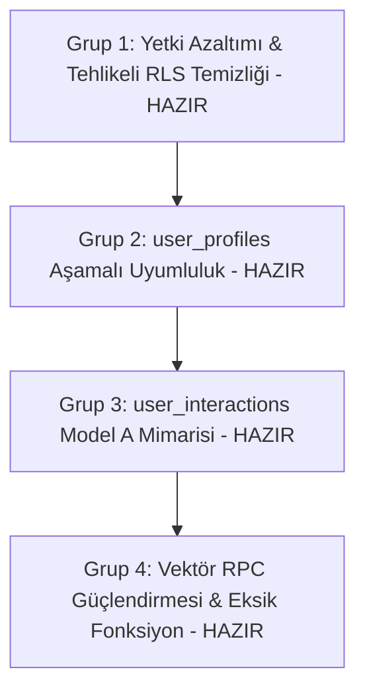

# Libris Database Remediation & Hardening Plan

**Tarih:** 2026-10-13  
**Durum:** Kıdemli İnceleme Sonrası Güncellendi (Review Passed & Blocked Gates Established)  
**Hedef Sistem:** Supabase PostgreSQL (`akifkeklik/book-ai-app`)

---

## 1. TEMEL İLKELER VE HEDEFLER

Bu plan, Libris üretim veritabanındaki güvenlik açıklarını kapatmak, repo ile canlı şemayı uzlaştırmak ve istemci uygulamalarının (Web, Flutter, Flask) çalışma kararlılığını sağlamak amacıyla tasarlanmıştır.

1. **Sıfır Veri Kaybı (Zero Data Loss):** Canlıda bulunan ~6.446 kitap, ~6.433 embedding ve mevcut 1 adet `user_profiles` kaydı kesinlikle silinmeyecek veya bozulmayacaktır.
2. **En Az Yetki İlkesi (Least Privilege):** RLS kurallarını baypas eden `TRUNCATE` yetkileri ve anonim yazma izinleri tamamen kaldırılacaktır.
3. **Aşamalı Geriye Dönük Uyumluluk (Staged Compatibility):** Canlı şemadaki kolonlar körlemesine yeniden adlandırılmayacak; eski ve yeni istemcilerin bir arada yaşayabilmesi için çift taraflı uyumluluk sağlanacaktır.
4. **Fail-Closed & Blokeli Güvenlik Kapıları:** Karara bağlanmamış veri modelleri (özellikle favori ve okuma durumu çatışması) otomatik uygulanmayacak, operatör onayına kadar kod seviyesinde bloke tutulacaktır.

---

## 2. HEDEF İZİN VE YETKİ MATRİSİ (LEAST PRIVILEGE MATRIX)

| Tablo | `anon` | `authenticated` | `service_role` | Gerekçe / Savunma |
|---|:---:|:---:|:---:|---|
| `public.books` | **SELECT** | **SELECT** | **ALL** | Kitap kataloğu genel okumaya açıktır. Anonim ve authenticated INSERT/UPDATE/DELETE/TRUNCATE tamamen yasaktır. |
| `public.book_embeddings` | **SELECT** | **SELECT** | **ALL** | `match_query_embeddings` fonksiyonu `SECURITY INVOKER` çalıştığından çağıran rollerin SELECT yetkisi korunmalıdır. Yazma yasaktır. |
| `public.favorites` | *YOK* | **S, I, U, D** | **ALL** | Anonim kullanıcı favori tutamaz. Kullanıcı sadece kendi satırlarına RLS (`auth.uid() = user_id`) ile erişir. |
| `public.user_activities` | *YOK* | **S, I** | **ALL** | Etkinlik logu immutable'dır (UPDATE/DELETE yetkisi verilmez). |
| `public.user_interactions` | *YOK* | **S, I, U, D** | **ALL** | Kullanıcı kendi beğeni ve koleksiyon kayıtlarını RLS ile yönetir. |
| `public.user_profiles` | *YOK* | **S, I, U** | **ALL** | Kullanıcı kendi profilini oluşturur ve günceller (DELETE yetkisi verilmez). |

### Kaldırılacak Tehlikeli Yetkiler:
- Tüm tablolarda `anon` ve `authenticated` rollerinden `TRUNCATE` yetkisi geri alınmalıdır (`REVOKE TRUNCATE`).
- `books` tablosundaki `python_ekleme_izni` ve `python_guncelleme_izni` politikaları silinmelidir (`DROP POLICY`).
- Rollback betiklerinde dahi `TRUNCATE` yetkisi asla geri verilmeyecektir (Fail-Safe Rollback).

---

## 3. ŞEMA VE VERİ MODELİ STRATEJİLERİ

### 3.1 `user_profiles` Şema Uzlaştırması (Aşamalı Çift Kolon Modeli)

#### Problem ve Risk Analizi:
Canlıda `id UUID PRIMARY KEY REFERENCES auth.users(id)` mevcuttur ve 1 adet kayıt vardır. Repo kodları (Flutter `supabase_service.dart`, Flask `supabase_adapters.py`, SQL `08_user_profiles_and_activities.sql`) `user_id` beklemektedir.
Doğrudan `ALTER TABLE user_profiles RENAME COLUMN id TO user_id;` çalıştırmak:
- Daha önce derlenmiş ve kullanıcıların cihazlarında yüklü olabilecek eski mobil sürümleri,
- Supabase Dashboard'daki doğrudan görünümleri,
- Varsa `id` alanını sorgulayan harici API/Edge function çağrılarını anında kırar.

#### Onaylanan Güvenli Strateji (Staged Compatibility):
1. `ALTER TABLE public.user_profiles ADD COLUMN IF NOT EXISTS user_id UUID REFERENCES auth.users(id);`
2. Mevcut tek satır için backfill: `UPDATE public.user_profiles SET user_id = id WHERE user_id IS NULL;`
3. `CREATE UNIQUE INDEX IF NOT EXISTS idx_user_profiles_user_id ON public.user_profiles(user_id);` (Flask ve Flutter'ın `on_conflict="user_id"` upsert'lerini destekler).
4. Bir `BEFORE INSERT OR UPDATE` trigger'ı (`sync_user_profile_identifiers`) tanımlanır:
   - Eski istemci `id` yazarsa `user_id` otomatik dolar.
   - Yeni istemci `user_id` yazarsa `id` otomatik dolar.
5. Eksik `preferred_authors TEXT[]` ve `preferred_vibe TEXT` kolonları eklenir.
6. RLS politikaları `auth.uid() = user_id OR auth.uid() = id` olarak güncellenir.
- **Sonuç:** Hem eski hem yeni kodlar sıfır kesintiyle çalışır; canlıdaki tek kayıt korunur.

---

### 3.2 `user_interactions` ve `favorites` Veri Modeli Çatışması (BLOKE DURUMDA)

#### Temel Mimari Çatışma:
`public.user_interactions` tablosunda `UNIQUE(user_id, book_id)` kısıtı vardır. Yani bir kullanıcı için bir kitaba ait **yalnızca tek bir satır** var olabilir.
- Eğer bir kullanıcı kitabı hem "Bitirdi" (`finished`) hem de "Favorilerine Ekledi" (`favorite`) ise:
  Tek bir kolonda (`interaction_type`) her iki değer aynı anda tutulamaz!
- Canlı trigger `ON CONFLICT DO UPDATE SET interaction_type = 'like'` yaptığında, okuma durumunu silip üzerine `'like'` yazmaktadır (Veri Kaybı).
- `ON CONFLICT DO NOTHING` yapıldığında ise, kitap `finished` kalmakta ancak kullanıcının kitabı favorilediği bilgisi `user_interactions` tablosuna hiç yansımamaktadır (Tavsiye motoru favoriyi göremez).

#### Operatör Kararı Gerektiren İki Model:
- **Model A (Bağımsız Nitelikler — ONAYLANDI):**
  `favorites` tablosu favorilerin bağımsız ve kanonik deposudur. `user_interactions` ise okuma durumları (`want_to_read`, `reading`, `finished`) ve ML beğeni sinyalleri (`like`, `dislike`, `favorite`) için kullanılır. Trigger, okuma durumlarını ezmez; kullanıcı favoriden çıkardığında okuma durumunu silmez.
- **Model B (Karşılıklı Dışlayan Koleksiyon Rafları):**
  Web UI'da olduğu gibi (`library.ts`), bir kitap aynı anda yalnızca tek bir rafta bulunabilir (`favorite` VEYA `reading` VEYA `finished`). Kullanıcı başka bir rafa taşıdığında önceki durumun ezilmesi ürün kuralı olarak kabul edilir.

> [!NOTE]
> **MODEL A ONAYLANDI:** Operatör tarafından Model A mimarisi onaylanmış, [`03_DRAFT_reconcile_interactions_and_trigger.sql`](file:///c:/Users/akifk/Desktop/book-ai-app/backend/scripts/hardening/03_DRAFT_reconcile_interactions_and_trigger.sql) betiği Model A kurallarına göre güncellenmiş ve [`test_03_interactions_and_trigger_runtime.sql`](file:///c:/Users/akifk/Desktop/book-ai-app/backend/scripts/hardening/test_03_interactions_and_trigger_runtime.sql) ile 8 runtime senaryosunda doğrulanmıştır.

---

### 3.3 RPC ve Vektör Arama Güvenliği Stratejisi

1. **`match_query_embeddings`:**
   - Fonksiyon `SECURITY INVOKER` olarak tutulmuştur (Gereksiz superuser yetkisi verilmez).
   - Sabit `search_path = public, pg_temp` eklenerek arama yolu manipülasyonu engellenmiştir.
   - Girdi tavanı (`safe_limit <= 100`) ve NULL denetimi eklenerek bellek şişmesi/DoS riski bertaraf edilmiştir.
   - `book_embeddings` tablosunda anon ve authenticated rolleri için `SELECT` izni korunmuştur.
2. **`match_book_embeddings`:**
   - Canlıda **EKSİK OLDUĞU DOĞRULANMIŞTIR**.
   - `04_DRAFT_harden_vector_rpcs.sql` betiğinde güvenli `SECURITY INVOKER` ve sabit `search_path` ile tanımlanmıştır.
   - Canlıya uygulanana kadar backend hibrit araması sessizce fallback vermeye devam edecektir.

---

## 4. DEPLOYMENT GRUPLARI VE ÇALIŞTIRMA KAPILARI

### Grup 1 — Yetki Azaltımı & Güvenlik Sıkılaştırma
- **Dosya:** `backend/scripts/hardening/01_DRAFT_revoke_dangerous_privileges.sql`
- **Durum:** **HAZIR / UYGULANABİLİR**
- **Etki:** `TRUNCATE` kaldırılır, `books` anonim yazma politikaları silinir. Sıfır kesinti, sıfır veri kaybı riski.

### Grup 2 — `user_profiles` Aşamalı Şema Uzlaştırması
- **Dosya:** `backend/scripts/hardening/02_DRAFT_reconcile_user_profiles.sql`
- **Durum:** **HAZIR / UYGULANABİLİR (Aşamalı Model)**
- **Etki:** Canlıdaki tek kayıt korunur, `user_id` kolonu eklenir, senkronizasyon trigger'ı kurulur. Eski ve yeni tüm sürümlerle uyumludur.

### Grup 3 — Etkileşim Kısıtı ve Model A Trigger Kurulumu
- **Dosya:** `backend/scripts/hardening/03_DRAFT_reconcile_interactions_and_trigger.sql`
- **Durum:** **HAZIR / UYGULANABİLİR (Model A Onaylandı)**
- **Etki:** `favorites` ile `user_interactions` bağımsız çalışır; okuma durumları ezilmez ve silinmez. Geriye dönük favoriler sıfır kayıpla senkronize edilir.

### Grup 4 — Vektör RPC ve Güvenlik Güçlendirmesi
- **Dosya:** `backend/scripts/hardening/04_DRAFT_harden_vector_rpcs.sql`
- **Durum:** **HAZIR / UYGULANABİLİR**
- **Etki:** `match_query_embeddings` search_path ve limit güvenliği kazanır; eksik `match_book_embeddings` tanımlanarak hibrit tavsiye motoru canlandırılır.

---

## 5. OPERATÖR ONAY GATES & İMZA LİSTESİ

Canlı veritabanına geçilmeden önce operatörün şu 3 kapıyı onaylaması şarttır:

- [ ] **Kapı 1 (Yedekleme):** Supabase konsolundan taze bir snapshot alındığı doğrulandı.
- [ ] **Kapı 2 (Grup 1, 2, 4 İcrası):** Hazır olan 01, 02 ve 04 numaralı hardening script'lerinin çalıştırılması onaylandı.
- [ ] **Kapı 3 (Grup 3 Mimari Kararı):** Favori ve Okuma Durumu için **Model A** (Bağımsız Nitelikler) mı yoksa **Model B** (Karşılıklı Dışlayan Raflar) mı seçileceği karara bağlandı.
